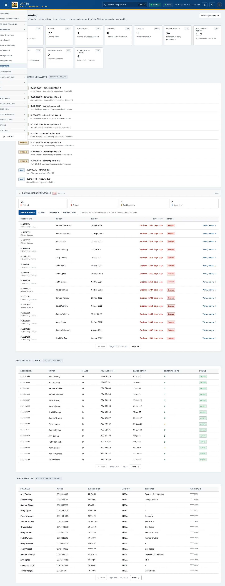
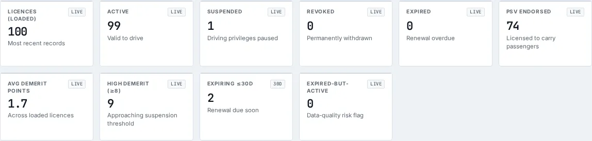

# Driver Licensing

_Public Transport › Driver Licensing_ · Route `/public-transport/driver-licensing`

**Driver Licensing** lets you see driver identity registry, driving-licence classes, endorsements, demerit points, PSV badges and expiry tracking. Data on this page comes from NTSA.

> 🎬 **Video tutorial:** _coming soon._  
> <!-- VIDEO-URL: public-transport/driver-licensing | paste the link here, e.g. [Watch the walkthrough](https://…) -->

## Highlights

- **10 headline tiles** — Licences (loaded), Active, Suspended, Revoked, Expired, PSV Endorsed….
- **2 panels** — PSV-Endorsed Licences, Driver Registry.
- **Refreshes itself every 120 seconds**, so you do not need to reload the page.
- Every figure is traceable to the data feed or upload template that supplies it — see [Data sources and feeds](#data-sources-and-feeds).

## Enabling and access

1. Sign in to UAPTS (see [How to access](../getting-started/how-to-access.md)).
2. In the left sidebar expand **Public Transport** and click **Driver Licensing**.
3. The page opens at `/public-transport/driver-licensing`. You can also reach it with the global search (**Ctrl + K**).

This page belongs to module **M04 · Public Transport**. The route needs at least the **Operator** tier to open it. The sidebar and the global search only list pages your agency and role can open, and a link to a page you cannot reach sends you back to the Command Centre. If a page you expect is missing, ask your agency administrator to check your agency's [Module Access](../access-control/module-access.md).

## Page tour

### Headline tiles

| Tile | What it shows | Data from | Table → ingested via |
|---|---|---|---|
| **Licences (loaded)** | Most recent records _(window: LIVE)_ | `/fleet/driver-licenses/` | _DriverLicense_ → no template yet |
| **Active** | Valid to drive _(window: LIVE)_ | — | — |
| **Suspended** | Driving privileges paused _(window: LIVE)_ | — | — |
| **Revoked** | Permanently withdrawn _(window: LIVE)_ | — | — |
| **Expired** | Renewal overdue _(window: LIVE)_ | — | — |
| **PSV Endorsed** | Licensed to carry passengers _(window: LIVE)_ | `/fleet/driver-licenses/` | _DriverLicense_ → no template yet |
| **Avg Demerit Points** | Across loaded licences _(window: LIVE)_ | `/fleet/driver-licenses/` | _DriverLicense_ → no template yet |
| **High Demerit (≥8)** | Approaching suspension threshold _(window: LIVE)_ | `/fleet/driver-licenses/`, `/fleet/driver-licenses/expiring/` | _DriverLicense_ → no template yet |
| **Expiring ≤30d** | Renewal due soon _(window: 30D)_ | `/fleet/driver-licenses/`, `/fleet/driver-licenses/expiring/` | _DriverLicense_ → no template yet |
| **Expired-but-Active** | Data-quality risk flag _(window: LIVE)_ | `/fleet/driver-licenses/`, `/fleet/driver-licenses/expiring/` | _DriverLicense_ → no template yet |

### PSV-Endorsed Licences

Contains a table with the columns **Licence No.**, **Driver**, **Class**, **PSV Badge No.**, **Badge Expiry**, **Demerit Points**, **Status**.

**Data from:** `/fleet/driver-licenses/`  
**Table → ingested via:** _DriverLicense_ → no template yet

### Driver Registry

Contains a table with the columns **Full Name**, **Phone**, **Date of Birth**, **Agency**, **Operator**, **National ID**, **Certificate**, **Owner**, **Expiry**, **Days left**, **Status**, **Action**.

**Data from:** `/fleet/driver-licenses/`, `/fleet/driver-licenses/expiring/`, `/fleet/drivers/`  
**Table → ingested via:** _DriverLicense, Driver_ → no template yet

## Working with this page

1. Open **Public Transport → Driver Licensing** from the sidebar.
2. Wait for the page to finish loading. It re-fetches its data every **120 s**; the figures you see are the latest the platform holds, not a one-time snapshot.
3. Scroll down to move through the panels; every panel has a heading matching those in the Page tour.

## Status and value meanings

These are the values the platform stores for the fields shown on this page (`value` followed by the label you see).

| Field | Table | Values |
|---|---|---|
| license class | DriverLicense | `A` A - Motorcycle · `B` B - Light Vehicle (personal) · `C` C - Medium/Heavy Truck · `D` D - PSV (Bus/Matatu) · `E` E - Articulated/Trailer · `F` F - Tractor/Agricultural Machinery · `G` G - Learner |
| status | DriverLicense | `active` · `suspended` · `revoked` · `expired` |

## Data sources and feeds

Every number and table on this page is read from the API endpoints below. The **Ingested via** column says how the underlying records get into UAPTS: a downloadable **upload template** (xlsx/CSV, loaded through the [Integration Hub](../integration-hub/upload-and-connect.md)), a **live feed** that pushes records to the ingest API, or — where neither exists yet — it is stated plainly.

| Endpoint | Records | Ingested via |
|---|---|---|
| `GET /fleet/driver-licenses/` | Driver Licenses | **No ingestion template yet** — populated by seed data or direct entry |
| `GET /fleet/driver-licenses/expiring/` | Driver Licenses | **No ingestion template yet** — populated by seed data or direct entry |
| `GET /fleet/drivers/` | Drivers | **No ingestion template yet** — populated by seed data or direct entry |

Full details of every template (columns, formats) are in the [Data sources catalogue](../reference/data-sources.md). Interactive API documentation is available at `/api/docs/`.

## Permissions

| Who | What they can do here |
|---|---|
| Public / read-only accounts | No access to this page. |
| Operator | View the page. |
| Analyst | View and **export CSV**. |
| Agency admin | Everything an analyst can do, plus the administrative capabilities listed in [Roles & Permissions](../access-control/roles-and-permissions.md). |
| Super admin | Sees every agency's data. |

**Agencies with the Public Transport module:** full — KURA, SDT, NTSA, NAMATA; selected pages only — COUNTY_GOV.

_Access is evaluated by the server from the baseline policy plus any agency overrides, so a super admin or agency admin may have changed it from the defaults above._

## Related topics

- [Operations Overview](operations-overview.md)
- [PSV Compliance](psv-compliance.md)
- [BRT Stops & Headway](brt-stops-headway.md)
- [Public Operators](public-operators.md)
- [Vehicle Registration](vehicle-registration.md)
- [Vehicle Inspections](vehicle-inspections.md)
- [Public Transport overview](index.md)
- [Upload & Connect (Integration Hub)](../integration-hub/upload-and-connect.md)
- [Data sources catalogue](../reference/data-sources.md)

## On this page

- [Highlights](#highlights)
- [Enabling and access](#enabling-and-access)
- [Page tour](#page-tour)
- [Working with this page](#working-with-this-page)
- [Status and value meanings](#status-and-value-meanings)
- [Data sources and feeds](#data-sources-and-feeds)
- [Permissions](#permissions)
- [Related topics](#related-topics)

## Support

- **Your agency administrator** is the first contact for access, role and data-quality questions.
- **Data feeds, templates and API questions:** `api-support@uapts.go.ke` (include the `X-Request-ID` response header from a failing call).
- **Security concerns:** `security@uapts.go.ke`. Do not report suspected vulnerabilities publicly.
