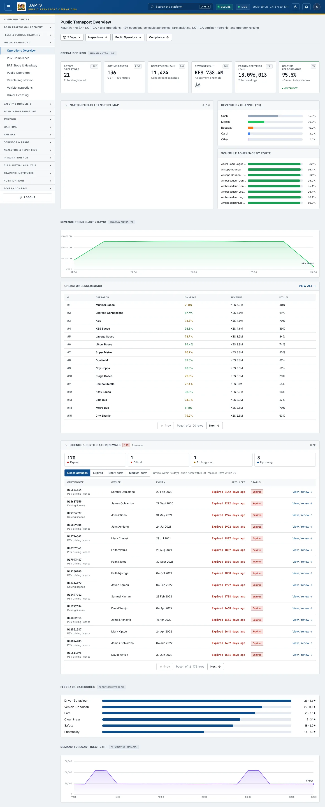
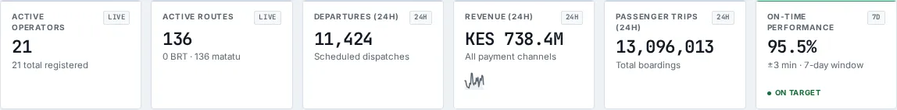
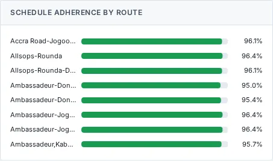
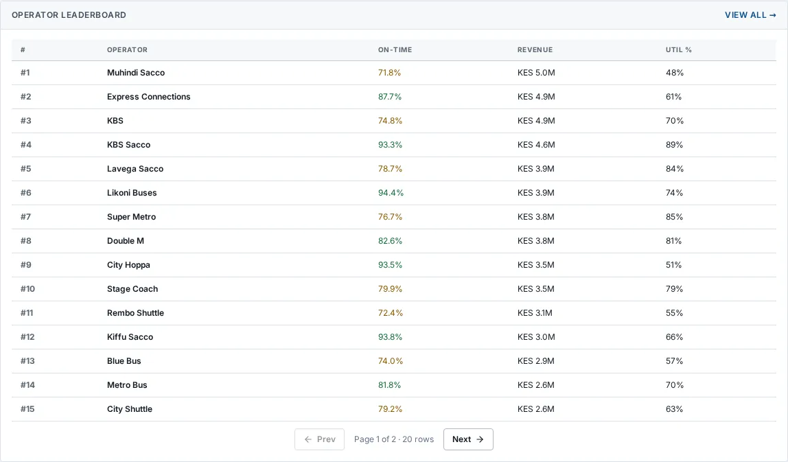

# Operations Overview

_Public Transport › Operations Overview_ · Route `/public-transport`

**Public Transport Overview** lets you see BRT operations, PSV oversight, schedule adherence, fare analytics, NCTTCA corridor ridership, and operator ranking. Data on this page comes from NaMATA, NTSA and NCTTCA.

> 🎬 **Video tutorial:** _coming soon._  
> <!-- VIDEO-URL: public-transport/operations-overview | paste the link here, e.g. [Watch the walkthrough](https://…) -->

## Highlights

- **6 headline tiles** — Active Operators, Active Routes, Departures (24h), Revenue (24h), Passenger Trips (24h), On-Time Performance.
- **5 panels** — Revenue by Channel (), Schedule Adherence by Route, Revenue Trend (), Operator Leaderboard, Demand Forecast (Next 24h).
- An **interactive map** with a legend, full-screen, locate-me and base-map controls.
- **Refreshes itself every 120 seconds**, so you do not need to reload the page.
- Every figure is traceable to the data feed or upload template that supplies it — see [Data sources and feeds](#data-sources-and-feeds).

## Enabling and access

1. Sign in to UAPTS (see [How to access](../getting-started/how-to-access.md)).
2. In the left sidebar expand **Public Transport** and click **Operations Overview**.
3. The page opens at `/public-transport`. You can also reach it with the global search (**Ctrl + K**).

This page belongs to module **M04 · Public Transport**. The sidebar and the global search only list pages your agency and role can open, and a link to a page you cannot reach sends you back to the Command Centre. If a page you expect is missing, ask your agency administrator to check your agency's [Module Access](../access-control/module-access.md).

## Page tour

### Headline tiles

| Tile | What it shows | Data from | Table → ingested via |
|---|---|---|---|
| **Active Operators** | — _(window: LIVE)_ | `/public-transport/operator-metrics/leaderboard/`, `/public-transport/summary/` | _OperatorMetric_ → computed by UAPTS |
| **Active Routes** | — _(window: LIVE)_ | `/public-transport/summary/` | _Route_ → [`namata-route-register`](../data-templates/namata-route-register.xlsx) |
| **Departures (24h)** | Scheduled dispatches _(window: 24H)_ | `/public-transport/summary/` | _Schedule_ → no template yet |
| **Revenue (24h)** | All payment channels _(window: 24H)_ | `/public-transport/fare-collections/revenue-trend/`, `/public-transport/summary/` | _FareCollection_ → no template yet |
| **Passenger Trips (24h)** | Total boardings _(window: 24H)_ | `/public-transport/summary/` | _PassengerFeedback_ → no template yet |
| **On-Time Performance** | ±3 min · 7-day window _(window: 7D)_ | `/public-transport/summary/` | aggregate of several tables — see [per-table feeds](#data-sources-and-feeds) |

### Revenue by Channel ()

**Data from:** `/public-transport/fare-collections/by-channel/`  
**Table → ingested via:** _FareCollection_ → no template yet

### Schedule Adherence by Route

**Data from:** `/public-transport/schedule-adherence/on-time/`  
**Table → ingested via:** _ScheduleAdherence_ → no template yet

### Revenue Trend ()

Contains a chart.

**Data from:** `/public-transport/fare-collections/revenue-trend/`, `/public-transport/operator-metrics/leaderboard/`  
**Table → ingested via:** _FareCollection, OperatorMetric_ → no template yet

### Operator Leaderboard

Contains a table with the columns **#**, **Operator**, **On-Time**, **Revenue**, **Util %**.

**Data from:** `/public-transport/operator-metrics/leaderboard/`  
**Table → ingested via:** _OperatorMetric_ → computed by UAPTS

### Demand Forecast (Next 24h)

Contains a chart and a table with the columns **Certificate**, **Owner**, **Expiry**, **Days left**, **Status**, **Action**.

**Data from:** `/public-transport/summary/`  
**Table → ingested via:** _DemandForecast_ → computed by UAPTS

## Working with this page

1. Open **Public Transport → Operations Overview** from the sidebar.
2. Wait for the page to finish loading. It re-fetches its data every **120 s**; the figures you see are the latest the platform holds, not a one-time snapshot.
3. On the map, drag to pan and scroll (or pinch) to zoom. Click a marker or line for its details. Use the map toolbar to go full-screen, centre on your location, reset the view or switch the base map; click the legend chip to expand it.

## Status and value meanings

These are the values the platform stores for the fields shown on this page (`value` followed by the label you see).

| Field | Table | Values |
|---|---|---|
| category | PassengerFeedback | `cleanliness` · `safety` · `punctuality` · `fare` · `driver_behaviour` · `vehicle_condition` · `other` |
| status | PassengerFeedback | `open` · `investigating` · `resolved` · `closed` |
| status | PSVLicense | `active` · `expired` · `suspended` · `revoked` |

## Data sources and feeds

Every number and table on this page is read from the API endpoints below. The **Ingested via** column says how the underlying records get into UAPTS: a downloadable **upload template** (xlsx/CSV, loaded through the [Integration Hub](../integration-hub/upload-and-connect.md)), a **live feed** that pushes records to the ingest API, or — where neither exists yet — it is stated plainly.

| Endpoint | Records | Ingested via |
|---|---|---|
| `GET /public-transport/brt-stops/` | Brt Stops | [`namata-brt-stop-register`](../data-templates/namata-brt-stop-register.xlsx) |
| `GET /public-transport/fare-collections/by-channel/` | Fare Collections | **No ingestion template yet** — populated by seed data or direct entry |
| `GET /public-transport/fare-collections/revenue-trend/` | Fare Collections | **No ingestion template yet** — populated by seed data or direct entry |
| `GET /public-transport/feedback/by-category/` | Passenger Feedbacks | **No ingestion template yet** — populated by seed data or direct entry |
| `GET /public-transport/operator-metrics/leaderboard/` | Operator Metrics | Computed by UAPTS from other data (no direct feed) |
| `GET /public-transport/psv-licenses/expiring/` | Psv Licenses | **No ingestion template yet** — populated by seed data or direct entry |
| `GET /public-transport/routes/` | Routes | [`namata-route-register`](../data-templates/namata-route-register.xlsx) |
| `GET /public-transport/schedule-adherence/on-time/` | Schedule Adherences | **No ingestion template yet** — populated by seed data or direct entry |
| `GET /public-transport/summary/` | _Aggregate of 9 tables (rows below)_ | — |
| ↳ DemandForecast | Demand Forecasts | Computed by UAPTS from other data (no direct feed) |
| ↳ FareCollection | Fare Collections | **No ingestion template yet** — populated by seed data or direct entry |
| ↳ OperatorMetric | Operator Metrics | Computed by UAPTS from other data (no direct feed) |
| ↳ PSVLicense | Psv Licenses | **No ingestion template yet** — populated by seed data or direct entry |
| ↳ PassengerFeedback | Passenger Feedbacks | **No ingestion template yet** — populated by seed data or direct entry |
| ↳ Route | Routes | [`namata-route-register`](../data-templates/namata-route-register.xlsx) |
| ↳ Sacco | Saccos | [`namata-sacco-register`](../data-templates/namata-sacco-register.xlsx) |
| ↳ Schedule | Schedules | **No ingestion template yet** — populated by seed data or direct entry |
| ↳ ScheduleAdherence | Schedule Adherences | **No ingestion template yet** — populated by seed data or direct entry |

Full details of every template (columns, formats) are in the [Data sources catalogue](../reference/data-sources.md). Interactive API documentation is available at `/api/docs/`.

## Permissions

| Who | What they can do here |
|---|---|
| Public / read-only accounts | View the page where the module is enabled for their agency (read-only). |
| Operator | View the page. |
| Analyst | View and **export CSV**. |
| Agency admin | Everything an analyst can do, plus the administrative capabilities listed in [Roles & Permissions](../access-control/roles-and-permissions.md). |
| Super admin | Sees every agency's data. |

**Agencies with the Public Transport module:** full — KURA, SDT, NTSA, NAMATA; selected pages only — COUNTY_GOV.

_Access is evaluated by the server from the baseline policy plus any agency overrides, so a super admin or agency admin may have changed it from the defaults above._

## Related topics

- [PSV Compliance](psv-compliance.md)
- [BRT Stops & Headway](brt-stops-headway.md)
- [Public Operators](public-operators.md)
- [Vehicle Registration](vehicle-registration.md)
- [Vehicle Inspections](vehicle-inspections.md)
- [Driver Licensing](driver-licensing.md)
- [Public Transport overview](index.md)
- [Upload & Connect (Integration Hub)](../integration-hub/upload-and-connect.md)
- [Data sources catalogue](../reference/data-sources.md)

## On this page

- [Highlights](#highlights)
- [Enabling and access](#enabling-and-access)
- [Page tour](#page-tour)
- [Working with this page](#working-with-this-page)
- [Status and value meanings](#status-and-value-meanings)
- [Data sources and feeds](#data-sources-and-feeds)
- [Permissions](#permissions)
- [Related topics](#related-topics)

## Support

- **Your agency administrator** is the first contact for access, role and data-quality questions.
- **Data feeds, templates and API questions:** `api-support@uapts.go.ke` (include the `X-Request-ID` response header from a failing call).
- **Security concerns:** `security@uapts.go.ke`. Do not report suspected vulnerabilities publicly.
