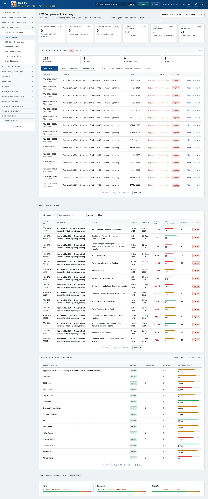
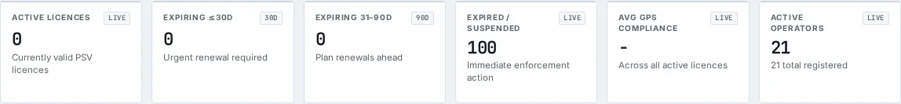
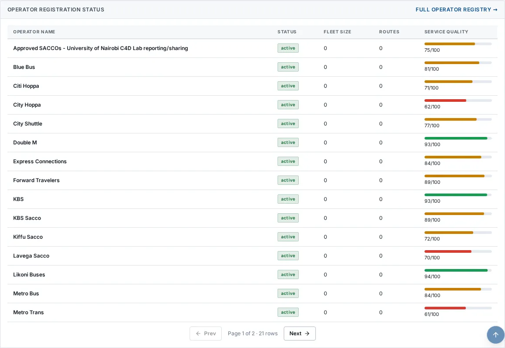

# PSV Compliance

_Public Transport › PSV Compliance_ · Route `/public-transport/compliance`

**PSV Compliance & Licensing** lets you see PSV licence status, expiry alerts, NaMATA route compliance, GPS tracking rates, and operator registration. Data on this page comes from NTSA and NaMATA.

> 🎬 **Video tutorial:** _coming soon._  
> <!-- VIDEO-URL: public-transport/psv-compliance | paste the link here, e.g. [Watch the walkthrough](https://…) -->

## Highlights

- **6 headline tiles** — Active Licences, Expiring ≤30d, Expiring 31–90d, Expired / Suspended, Avg GPS Compliance, Active Operators.
- **3 panels** — PSV Licence Registry, Operator Registration Status Full operator registry, Compliance by Check Type.
- **Refreshes itself every 120 seconds**, so you do not need to reload the page.
- **Filters and search** to narrow tables to what you need.
- Every figure is traceable to the data feed or upload template that supplies it — see [Data sources and feeds](#data-sources-and-feeds).

## Enabling and access

1. Sign in to UAPTS (see [How to access](../getting-started/how-to-access.md)).
2. In the left sidebar expand **Public Transport** and click **PSV Compliance**.
3. The page opens at `/public-transport/compliance`. You can also reach it with the global search (**Ctrl + K**).

This page belongs to module **M04 · Public Transport**. The sidebar and the global search only list pages your agency and role can open, and a link to a page you cannot reach sends you back to the Command Centre. If a page you expect is missing, ask your agency administrator to check your agency's [Module Access](../access-control/module-access.md).

## Page tour

### Headline tiles

| Tile | What it shows | Data from | Table → ingested via |
|---|---|---|---|
| **Active Licences** | Currently valid PSV licences _(window: LIVE)_ | `/public-transport/psv-licenses/`, `/public-transport/psv-licenses/expiring/` | _PSVLicense_ → no template yet |
| **Expiring ≤30d** | Urgent renewal required _(window: 30D)_ | `/public-transport/psv-licenses/`, `/public-transport/psv-licenses/expiring/` | _PSVLicense_ → no template yet |
| **Expiring 31–90d** | Plan renewals ahead _(window: 90D)_ | `/public-transport/psv-licenses/`, `/public-transport/psv-licenses/expiring/` | _PSVLicense_ → no template yet |
| **Expired / Suspended** | Immediate enforcement action _(window: LIVE)_ | `/public-transport/psv-licenses/`, `/public-transport/psv-licenses/expiring/` | _PSVLicense_ → no template yet |
| **Avg GPS Compliance** | Across all active licences _(window: LIVE)_ | `/public-transport/psv-licenses/` | _PSVLicense_ → no template yet |
| **Active Operators** | — _(window: LIVE)_ | `/public-transport/saccos/` | _Sacco_ → [`namata-sacco-register`](../data-templates/namata-sacco-register.xlsx) |

### PSV Licence Registry

Contains a table with the columns **Licence No.**, **Operator**, **Route**, **Issued**, **Expires**, **Days Left**, **GPS Compliance**, **Vehicles**, **Status**.

**Data from:** `/public-transport/psv-licenses/`  
**Table → ingested via:** _PSVLicense_ → no template yet

### Operator Registration Status Full operator registry

Contains a table with the columns **Operator Name**, **Status**, **Fleet Size**, **Routes**, **Service Quality**.

**Data from:** `/public-transport/saccos/`  
**Table → ingested via:** _Sacco_ → [`namata-sacco-register`](../data-templates/namata-sacco-register.xlsx)

### Compliance by Check Type

Contains a table with the columns **Certificate**, **Owner**, **Expiry**, **Days left**, **Status**, **Action**.

**Data from:** `/public-transport/compliance/summary/`  
**Table → ingested via:** _RouteCompliance_ → no template yet

## Working with this page

1. Open **Public Transport → PSV Compliance** from the sidebar.
2. Wait for the page to finish loading. It re-fetches its data every **120 s**; the figures you see are the latest the platform holds, not a one-time snapshot.
3. Type in the **“Search operator…”** box to filter what is shown.
4. Use the **All statuses** drop-down to narrow the list. Choices include: Active, Expired, Suspended, Revoked.
5. Click **Apply** to use this action.

## Status and value meanings

These are the values the platform stores for the fields shown on this page (`value` followed by the label you see).

| Field | Table | Values |
|---|---|---|
| status | RouteCompliance | `compliant` · `flagged` · `violation` |
| status | PSVLicense | `active` · `expired` · `suspended` · `revoked` |
| registration status | Sacco | `active` · `suspended` · `revoked` |

## Data sources and feeds

Every number and table on this page is read from the API endpoints below. The **Ingested via** column says how the underlying records get into UAPTS: a downloadable **upload template** (xlsx/CSV, loaded through the [Integration Hub](../integration-hub/upload-and-connect.md)), a **live feed** that pushes records to the ingest API, or — where neither exists yet — it is stated plainly.

| Endpoint | Records | Ingested via |
|---|---|---|
| `GET /public-transport/compliance/summary/` | Route Compliances | **No ingestion template yet** — populated by seed data or direct entry |
| `GET /public-transport/psv-licenses/` | Psv Licenses | **No ingestion template yet** — populated by seed data or direct entry |
| `GET /public-transport/psv-licenses/expiring/` | Psv Licenses | **No ingestion template yet** — populated by seed data or direct entry |
| `GET /public-transport/saccos/` | Saccos | [`namata-sacco-register`](../data-templates/namata-sacco-register.xlsx) |

Full details of every template (columns, formats) are in the [Data sources catalogue](../reference/data-sources.md). Interactive API documentation is available at `/api/docs/`.

## Permissions

| Who | What they can do here |
|---|---|
| Public / read-only accounts | View the page where the module is enabled for their agency (read-only). |
| Operator | View the page. |
| Analyst | View and **export CSV**. |
| Agency admin | Everything an analyst can do, plus the administrative capabilities listed in [Roles & Permissions](../access-control/roles-and-permissions.md). |
| Super admin | Sees every agency's data. |

**Agencies with the Public Transport module:** full — KURA, SDT, NTSA, NAMATA; selected pages only — COUNTY_GOV.

_Access is evaluated by the server from the baseline policy plus any agency overrides, so a super admin or agency admin may have changed it from the defaults above._

## Related topics

- [Operations Overview](operations-overview.md)
- [BRT Stops & Headway](brt-stops-headway.md)
- [Public Operators](public-operators.md)
- [Vehicle Registration](vehicle-registration.md)
- [Vehicle Inspections](vehicle-inspections.md)
- [Driver Licensing](driver-licensing.md)
- [Public Transport overview](index.md)
- [Upload & Connect (Integration Hub)](../integration-hub/upload-and-connect.md)
- [Data sources catalogue](../reference/data-sources.md)

## On this page

- [Highlights](#highlights)
- [Enabling and access](#enabling-and-access)
- [Page tour](#page-tour)
- [Working with this page](#working-with-this-page)
- [Status and value meanings](#status-and-value-meanings)
- [Data sources and feeds](#data-sources-and-feeds)
- [Permissions](#permissions)
- [Related topics](#related-topics)

## Support

- **Your agency administrator** is the first contact for access, role and data-quality questions.
- **Data feeds, templates and API questions:** `api-support@uapts.go.ke` (include the `X-Request-ID` response header from a failing call).
- **Security concerns:** `security@uapts.go.ke`. Do not report suspected vulnerabilities publicly.
