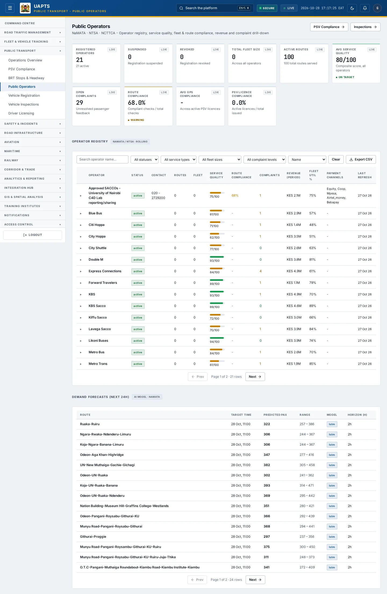
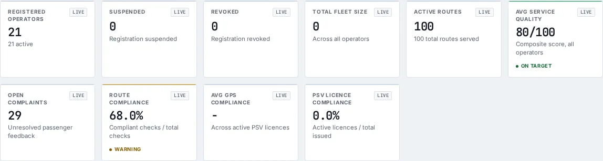

# Public Operators

_Public Transport › Public Operators_ · Route `/public-transport/operators`

**Public Operators** lets you see operator registry, service quality, fleet & route compliance, revenue and complaint drill-down. Data on this page comes from NaMATA, NTSA and NCTTCA.

> 🎬 **Video tutorial:** _coming soon._  
> <!-- VIDEO-URL: public-transport/public-operators | paste the link here, e.g. [Watch the walkthrough](https://…) -->

## Highlights

- **10 headline tiles** — Registered Operators, Suspended, Revoked, Total Fleet Size, Active Routes, Avg Service Quality….
- **2 panels** — Operator Registry, Demand Forecasts (Next 24h).
- **Refreshes itself every 120 seconds**, so you do not need to reload the page.
- **Export to CSV** for the rows you are looking at (Analyst tier and above).
- **Filters and search** to narrow tables to what you need.
- Every figure is traceable to the data feed or upload template that supplies it — see [Data sources and feeds](#data-sources-and-feeds).

## Enabling and access

1. Sign in to UAPTS (see [How to access](../getting-started/how-to-access.md)).
2. In the left sidebar expand **Public Transport** and click **Public Operators**.
3. The page opens at `/public-transport/operators`. You can also reach it with the global search (**Ctrl + K**).

This page belongs to module **M04 · Public Transport**. The sidebar and the global search only list pages your agency and role can open, and a link to a page you cannot reach sends you back to the Command Centre. If a page you expect is missing, ask your agency administrator to check your agency's [Module Access](../access-control/module-access.md).

## Page tour

### Headline tiles

| Tile | What it shows | Data from | Table → ingested via |
|---|---|---|---|
| **Registered Operators** | — _(window: LIVE)_ | `/public-transport/compliance/`, `/public-transport/feedback/`, `/public-transport/psv-licenses/` | _RouteCompliance, PassengerFeedback, PSVLicense, Route, Sacco_ → [`namata-route-register`](../data-templates/namata-route-register.xlsx) [`namata-sacco-register`](../data-templates/namata-sacco-register.xlsx) |
| **Suspended** | Registration suspended _(window: LIVE)_ | `/public-transport/compliance/`, `/public-transport/feedback/`, `/public-transport/psv-licenses/` | _RouteCompliance, PassengerFeedback, PSVLicense, Route, Sacco_ → [`namata-route-register`](../data-templates/namata-route-register.xlsx) [`namata-sacco-register`](../data-templates/namata-sacco-register.xlsx) |
| **Revoked** | Registration revoked _(window: LIVE)_ | `/public-transport/compliance/`, `/public-transport/feedback/`, `/public-transport/psv-licenses/` | _RouteCompliance, PassengerFeedback, PSVLicense, Route, Sacco_ → [`namata-route-register`](../data-templates/namata-route-register.xlsx) [`namata-sacco-register`](../data-templates/namata-sacco-register.xlsx) |
| **Total Fleet Size** | Across all operators _(window: LIVE)_ | `/public-transport/compliance/`, `/public-transport/feedback/`, `/public-transport/operator-metrics/` | _RouteCompliance, PassengerFeedback, OperatorMetric, PaymentTransaction, PSVLicense, Route, Sacco, ServiceQualityScore_ → [`namata-route-register`](../data-templates/namata-route-register.xlsx) [`namata-sacco-register`](../data-templates/namata-sacco-register.xlsx) |
| **Active Routes** | — _(window: LIVE)_ | `/public-transport/compliance/`, `/public-transport/feedback/`, `/public-transport/psv-licenses/` | _RouteCompliance, PassengerFeedback, PSVLicense, Route, Sacco_ → [`namata-route-register`](../data-templates/namata-route-register.xlsx) [`namata-sacco-register`](../data-templates/namata-sacco-register.xlsx) |
| **Avg Service Quality** | Composite score, all operators _(window: LIVE)_ | `/public-transport/compliance/`, `/public-transport/feedback/`, `/public-transport/operator-metrics/` | _RouteCompliance, PassengerFeedback, OperatorMetric, PaymentTransaction, PSVLicense, Route, Sacco, ServiceQualityScore_ → [`namata-route-register`](../data-templates/namata-route-register.xlsx) [`namata-sacco-register`](../data-templates/namata-sacco-register.xlsx) |
| **Open Complaints** | Unresolved passenger feedback _(window: LIVE)_ | `/public-transport/compliance/`, `/public-transport/feedback/`, `/public-transport/psv-licenses/` | _RouteCompliance, PassengerFeedback, PSVLicense, Route, Sacco_ → [`namata-route-register`](../data-templates/namata-route-register.xlsx) [`namata-sacco-register`](../data-templates/namata-sacco-register.xlsx) |
| **Route Compliance** | Compliant checks / total checks _(window: LIVE)_ | `/public-transport/compliance/`, `/public-transport/feedback/`, `/public-transport/psv-licenses/` | _RouteCompliance, PassengerFeedback, PSVLicense, Route, Sacco_ → [`namata-route-register`](../data-templates/namata-route-register.xlsx) [`namata-sacco-register`](../data-templates/namata-sacco-register.xlsx) |
| **Avg GPS Compliance** | Across active PSV licences _(window: LIVE)_ | `/public-transport/compliance/`, `/public-transport/feedback/`, `/public-transport/psv-licenses/` | _RouteCompliance, PassengerFeedback, PSVLicense, Route, Sacco_ → [`namata-route-register`](../data-templates/namata-route-register.xlsx) [`namata-sacco-register`](../data-templates/namata-sacco-register.xlsx) |
| **PSV Licence Compliance** | Active licences / total issued _(window: LIVE)_ | `/public-transport/compliance/`, `/public-transport/feedback/`, `/public-transport/psv-licenses/` | _RouteCompliance, PassengerFeedback, PSVLicense, Route, Sacco_ → [`namata-route-register`](../data-templates/namata-route-register.xlsx) [`namata-sacco-register`](../data-templates/namata-sacco-register.xlsx) |

### Operator Registry

Contains a table with the columns **Operator**, **Status**, **Contact**, **Routes**, **Fleet**, **Service Quality**, **Route Compliance**, **Complaints**, **Revenue (period)**, **Fleet Util %**, **Payment Channels**, **Last Refresh**.

**Data from:** `/public-transport/compliance/`, `/public-transport/demand-forecasts/`, `/public-transport/feedback/`, `/public-transport/operator-metrics/`, `/public-transport/payments/`, `/public-transport/psv-licenses/`, `/public-transport/routes/`, `/public-transport/saccos/`, `/public-transport/service-quality/`  
**Table → ingested via:** _RouteCompliance, DemandForecast, PassengerFeedback, OperatorMetric, PaymentTransaction, PSVLicense, Route, Sacco, ServiceQualityScore_ → [`namata-route-register`](../data-templates/namata-route-register.xlsx) [`namata-sacco-register`](../data-templates/namata-sacco-register.xlsx)

### Demand Forecasts (Next 24h)

Contains a table with the columns **Route**, **Target Time**, **Predicted Pax**, **Range**, **Model**, **Horizon (h)**.

**Data from:** `/public-transport/demand-forecasts/`  
**Table → ingested via:** _DemandForecast_ → computed by UAPTS

## Working with this page

1. Open **Public Transport → Public Operators** from the sidebar.
2. Wait for the page to finish loading. It re-fetches its data every **120 s**; the figures you see are the latest the platform holds, not a one-time snapshot.
3. Type in the **“Search operator name…”** box to filter what is shown.
4. Use the **All statuses** drop-down to narrow the list. Choices include: Active, Suspended, Revoked.
5. Use the **All service types** drop-down to narrow the list. Choices include: Matatu, BRT, Ferry, Rail.
6. Use the **All fleet sizes** drop-down to narrow the list. Choices include: Small (&lt; 20 vehicles), Medium (20-49), Large (50+).
7. Use the **All complaint levels** drop-down to narrow the list. Choices include: Has open complaints, No open complaints.
8. Use the **Name** drop-down to narrow the list. Choices include: Fleet size, Service quality, Route compliance, Complaints, Revenue.
9. Click a row to open its detail.
10. Click **Export CSV** to download the rows currently loaded (after filters). The button only appears for Analyst tier and above.

## Status and value meanings

These are the values the platform stores for the fields shown on this page (`value` followed by the label you see).

| Field | Table | Values |
|---|---|---|
| check type | RouteCompliance | `licensing` · `fare` · `capacity` · `safety` |
| status | RouteCompliance | `compliant` · `flagged` · `violation` |
| category | PassengerFeedback | `cleanliness` · `safety` · `punctuality` · `fare` · `driver_behaviour` · `vehicle_condition` · `other` |
| status | PassengerFeedback | `open` · `investigating` · `resolved` · `closed` |
| status | PSVLicense | `active` · `expired` · `suspended` · `revoked` |
| service type | Route | `brt` · `matatu` Matatu / PSV · `ferry` · `rail` |
| registration status | Sacco | `active` · `suspended` · `revoked` |

## Data sources and feeds

Every number and table on this page is read from the API endpoints below. The **Ingested via** column says how the underlying records get into UAPTS: a downloadable **upload template** (xlsx/CSV, loaded through the [Integration Hub](../integration-hub/upload-and-connect.md)), a **live feed** that pushes records to the ingest API, or — where neither exists yet — it is stated plainly.

| Endpoint | Records | Ingested via |
|---|---|---|
| `GET /public-transport/compliance/` | Route Compliances | **No ingestion template yet** — populated by seed data or direct entry |
| `GET /public-transport/demand-forecasts/` | Demand Forecasts | Computed by UAPTS from other data (no direct feed) |
| `GET /public-transport/feedback/` | Passenger Feedbacks | **No ingestion template yet** — populated by seed data or direct entry |
| `GET /public-transport/operator-metrics/` | Operator Metrics | Computed by UAPTS from other data (no direct feed) |
| `GET /public-transport/payments/` | Payment Transactions | **No ingestion template yet** — populated by seed data or direct entry |
| `GET /public-transport/psv-licenses/` | Psv Licenses | **No ingestion template yet** — populated by seed data or direct entry |
| `GET /public-transport/routes/` | Routes | [`namata-route-register`](../data-templates/namata-route-register.xlsx) |
| `GET /public-transport/saccos/` | Saccos | [`namata-sacco-register`](../data-templates/namata-sacco-register.xlsx) |
| `GET /public-transport/service-quality/` | Service Quality Scores | Computed by UAPTS from other data (no direct feed) |

Full details of every template (columns, formats) are in the [Data sources catalogue](../reference/data-sources.md). Interactive API documentation is available at `/api/docs/`.

## Permissions

| Who | What they can do here |
|---|---|
| Public / read-only accounts | View the page where the module is enabled for their agency (read-only). |
| Operator | View the page. |
| Analyst | View and **export CSV**. |
| Agency admin | Everything an analyst can do, plus the administrative capabilities listed in [Roles & Permissions](../access-control/roles-and-permissions.md). |
| Super admin | Sees every agency's data. |

**Agencies with the Public Transport module:** full — KURA, SDT, NTSA, NAMATA; selected pages only — COUNTY_GOV.

_Access is evaluated by the server from the baseline policy plus any agency overrides, so a super admin or agency admin may have changed it from the defaults above._

## Related topics

- [Operations Overview](operations-overview.md)
- [PSV Compliance](psv-compliance.md)
- [BRT Stops & Headway](brt-stops-headway.md)
- [Vehicle Registration](vehicle-registration.md)
- [Vehicle Inspections](vehicle-inspections.md)
- [Driver Licensing](driver-licensing.md)
- [Public Transport overview](index.md)
- [Upload & Connect (Integration Hub)](../integration-hub/upload-and-connect.md)
- [Data sources catalogue](../reference/data-sources.md)

## On this page

- [Highlights](#highlights)
- [Enabling and access](#enabling-and-access)
- [Page tour](#page-tour)
- [Working with this page](#working-with-this-page)
- [Status and value meanings](#status-and-value-meanings)
- [Data sources and feeds](#data-sources-and-feeds)
- [Permissions](#permissions)
- [Related topics](#related-topics)

## Support

- **Your agency administrator** is the first contact for access, role and data-quality questions.
- **Data feeds, templates and API questions:** `api-support@uapts.go.ke` (include the `X-Request-ID` response header from a failing call).
- **Security concerns:** `security@uapts.go.ke`. Do not report suspected vulnerabilities publicly.
