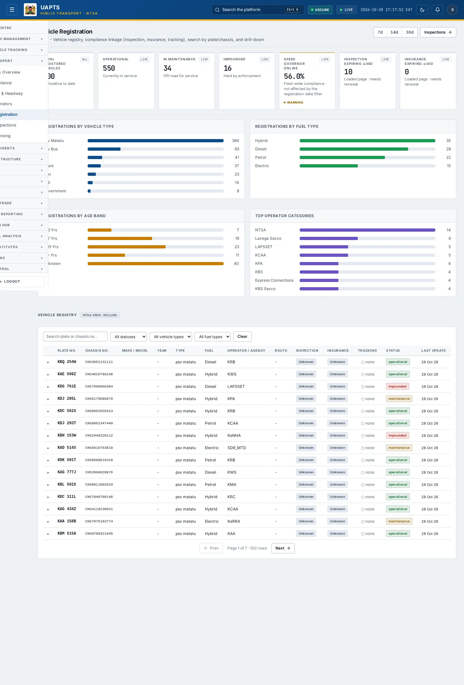
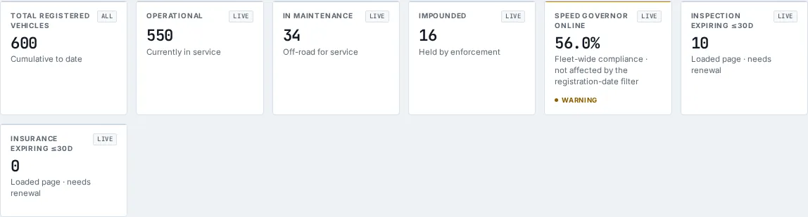
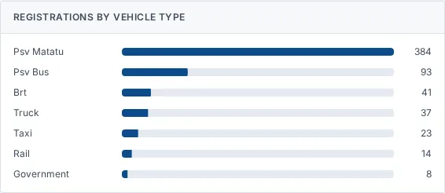
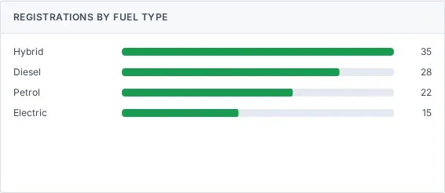
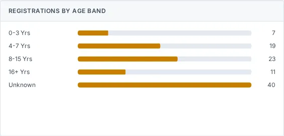
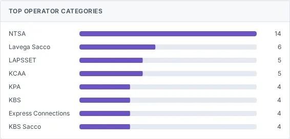

# Vehicle Registration

_Public Transport › Vehicle Registration_ · Route `/public-transport/vehicle-registration`

**Vehicle Registration** lets you see vehicle registry, compliance linkage (inspection, insurance, tracking), search by plate/chassis, and drill-down. Data on this page comes from NTSA.

> 🎬 **Video tutorial:** _coming soon._  
> <!-- VIDEO-URL: public-transport/vehicle-registration | paste the link here, e.g. [Watch the walkthrough](https://…) -->

## Highlights

- **7 headline tiles** — Total Registered Vehicles, Operational, In Maintenance, Impounded, Speed Governor Online, Inspection Expiring ≤30d….
- **5 panels** — Registrations by Vehicle Type, Registrations by Fuel Type, Registrations by Age Band, Top Operator Categories, Vehicle Registry.
- **Refreshes itself every 120 seconds**, so you do not need to reload the page.
- **Filters and search** to narrow tables to what you need.
- Every figure is traceable to the data feed or upload template that supplies it — see [Data sources and feeds](#data-sources-and-feeds).

## Enabling and access

1. Sign in to UAPTS (see [How to access](../getting-started/how-to-access.md)).
2. In the left sidebar expand **Public Transport** and click **Vehicle Registration**.
3. The page opens at `/public-transport/vehicle-registration`. You can also reach it with the global search (**Ctrl + K**).

This page belongs to module **M04 · Public Transport**. The route needs at least the **Operator** tier to open it. The sidebar and the global search only list pages your agency and role can open, and a link to a page you cannot reach sends you back to the Command Centre. If a page you expect is missing, ask your agency administrator to check your agency's [Module Access](../access-control/module-access.md).

## Page tour

### Headline tiles

| Tile | What it shows | Data from | Table → ingested via |
|---|---|---|---|
| **Total Registered Vehicles** | — | `/fleet/summary/`, `/fleet/vehicles/` | _Vehicle_ → [`ntsa-psv-fleet-register`](../data-templates/ntsa-psv-fleet-register.xlsx) |
| **Operational** | — | `/fleet/summary/`, `/fleet/vehicles/` | _Vehicle_ → [`ntsa-psv-fleet-register`](../data-templates/ntsa-psv-fleet-register.xlsx) |
| **In Maintenance** | — | `/fleet/summary/`, `/fleet/vehicles/` | _Vehicle_ → [`ntsa-psv-fleet-register`](../data-templates/ntsa-psv-fleet-register.xlsx) |
| **Impounded** | — | `/fleet/summary/`, `/fleet/vehicles/` | _Vehicle_ → [`ntsa-psv-fleet-register`](../data-templates/ntsa-psv-fleet-register.xlsx) |
| **Speed Governor Online** | Fleet-wide compliance · not affected by the registration-date filter _(window: LIVE)_ | `/fleet/summary/` | _SpeedGovernorStatus_ → live telemetry push (no template yet) |
| **Inspection Expiring ≤30d** | — | `/fleet/vehicles/` | _Vehicle_ → [`ntsa-psv-fleet-register`](../data-templates/ntsa-psv-fleet-register.xlsx) |
| **Insurance Expiring ≤30d** | — | `/fleet/vehicles/` | _Vehicle_ → [`ntsa-psv-fleet-register`](../data-templates/ntsa-psv-fleet-register.xlsx) |

### Registrations by Vehicle Type

**Data from:** `/fleet/summary/`, `/fleet/vehicles/`  
**Table → ingested via:** _Vehicle_ → [`ntsa-psv-fleet-register`](../data-templates/ntsa-psv-fleet-register.xlsx)

### Registrations by Fuel Type

**Data from:** `/fleet/vehicles/`  
**Table → ingested via:** _Vehicle_ → [`ntsa-psv-fleet-register`](../data-templates/ntsa-psv-fleet-register.xlsx)

### Registrations by Age Band

**Data from:** `/fleet/vehicles/`  
**Table → ingested via:** _Vehicle_ → [`ntsa-psv-fleet-register`](../data-templates/ntsa-psv-fleet-register.xlsx)

### Top Operator Categories

**Data from:** `/fleet/vehicles/`  
**Table → ingested via:** _Vehicle_ → [`ntsa-psv-fleet-register`](../data-templates/ntsa-psv-fleet-register.xlsx)

### Vehicle Registry

Contains a table with the columns **Plate No.**, **Chassis No.**, **Make / Model**, **Year**, **Type**, **Fuel**, **Operator / Agency**, **Route**, **Inspection**, **Insurance**, **Tracking**, **Status**, **Last Update**.

**Data from:** `/fleet/vehicles/`  
**Table → ingested via:** _Vehicle_ → [`ntsa-psv-fleet-register`](../data-templates/ntsa-psv-fleet-register.xlsx)

## Working with this page

1. Open **Public Transport → Vehicle Registration** from the sidebar.
2. Wait for the page to finish loading. It re-fetches its data every **120 s**; the figures you see are the latest the platform holds, not a one-time snapshot.
3. Type in the **“Search plate or chassis no…”** box to filter what is shown.
4. Use the **All statuses** drop-down to narrow the list. Choices include: Operational, Maintenance, Impounded.
5. Use the date-range / day toggle above the charts to change the reporting window; the tiles and charts update together.
6. Click a row to open its detail.

## Status and value meanings

These are the values the platform stores for the fields shown on this page (`value` followed by the label you see).

| Field | Table | Values |
|---|---|---|
| event type | DriverBehaviorEvent | `speeding` · `harsh_brake` Harsh Braking · `harsh_accel` Harsh Acceleration · `excessive_idle` Excessive Idling · `sharp_turn` |
| severity | DriverBehaviorEvent | `low` · `medium` · `high` · `critical` |
| result | VehicleInspection | `pass` · `fail` · `conditional_pass` |
| vehicle type | Vehicle | `psv_matatu` · `psv_bus` · `brt` · `taxi` · `truck` · `government` · `private` · `rail` |
| status | Vehicle | `operational` · `maintenance` · `impounded` |

## Data sources and feeds

Every number and table on this page is read from the API endpoints below. The **Ingested via** column says how the underlying records get into UAPTS: a downloadable **upload template** (xlsx/CSV, loaded through the [Integration Hub](../integration-hub/upload-and-connect.md)), a **live feed** that pushes records to the ingest API, or — where neither exists yet — it is stated plainly.

| Endpoint | Records | Ingested via |
|---|---|---|
| `GET /fleet/driver-behavior-events/` | Driver Behavior Events | Live telemetry — push via `POST /api/v1/integrations/<source_id>/ingest/`; **no template or handler yet** |
| `GET /fleet/route-adherence/` | Route Adherences | Live telemetry — push via `POST /api/v1/integrations/<source_id>/ingest/`; **no template or handler yet** |
| `GET /fleet/summary/` | _Aggregate of 5 tables (rows below)_ | — |
| ↳ DriverBehaviorEvent | Driver Behavior Events | Live telemetry — push via `POST /api/v1/integrations/<source_id>/ingest/`; **no template or handler yet** |
| ↳ GeofenceEvent | Geofence Events | Live telemetry — push via `POST /api/v1/integrations/<source_id>/ingest/`; **no template or handler yet** |
| ↳ SpeedGovernorStatus | Speed Governor Statuss | Live telemetry — push via `POST /api/v1/integrations/<source_id>/ingest/`; **no template or handler yet** |
| ↳ TripPlayback | Trip Playbacks | Live telemetry — push via `POST /api/v1/integrations/<source_id>/ingest/`; **no template or handler yet** |
| ↳ Vehicle | Vehicles | [`ntsa-psv-fleet-register`](../data-templates/ntsa-psv-fleet-register.xlsx) |
| `GET /fleet/vehicle-inspections/` | Vehicle Inspections | **No ingestion template yet** — populated by seed data or direct entry |
| `GET /fleet/vehicles/` | Vehicles | [`ntsa-psv-fleet-register`](../data-templates/ntsa-psv-fleet-register.xlsx) |

Full details of every template (columns, formats) are in the [Data sources catalogue](../reference/data-sources.md). Interactive API documentation is available at `/api/docs/`.

## Permissions

| Who | What they can do here |
|---|---|
| Public / read-only accounts | No access to this page. |
| Operator | View the page. |
| Analyst | View and **export CSV**. |
| Agency admin | Everything an analyst can do, plus the administrative capabilities listed in [Roles & Permissions](../access-control/roles-and-permissions.md). |
| Super admin | Sees every agency's data. |

**Agencies with the Public Transport module:** full — KURA, SDT, NTSA, NAMATA; selected pages only — COUNTY_GOV.

_Access is evaluated by the server from the baseline policy plus any agency overrides, so a super admin or agency admin may have changed it from the defaults above._

## Related topics

- [Operations Overview](operations-overview.md)
- [PSV Compliance](psv-compliance.md)
- [BRT Stops & Headway](brt-stops-headway.md)
- [Public Operators](public-operators.md)
- [Vehicle Inspections](vehicle-inspections.md)
- [Driver Licensing](driver-licensing.md)
- [Public Transport overview](index.md)
- [Upload & Connect (Integration Hub)](../integration-hub/upload-and-connect.md)
- [Data sources catalogue](../reference/data-sources.md)

## On this page

- [Highlights](#highlights)
- [Enabling and access](#enabling-and-access)
- [Page tour](#page-tour)
- [Working with this page](#working-with-this-page)
- [Status and value meanings](#status-and-value-meanings)
- [Data sources and feeds](#data-sources-and-feeds)
- [Permissions](#permissions)
- [Related topics](#related-topics)

## Support

- **Your agency administrator** is the first contact for access, role and data-quality questions.
- **Data feeds, templates and API questions:** `api-support@uapts.go.ke` (include the `X-Request-ID` response header from a failing call).
- **Security concerns:** `security@uapts.go.ke`. Do not report suspected vulnerabilities publicly.
