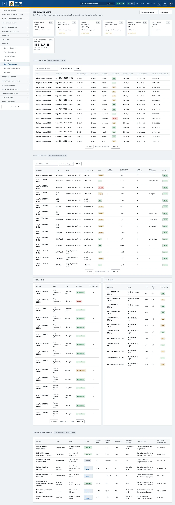
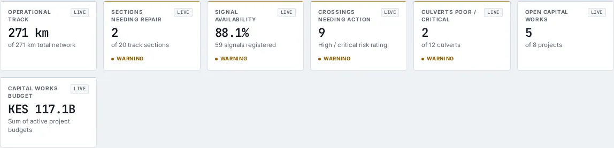
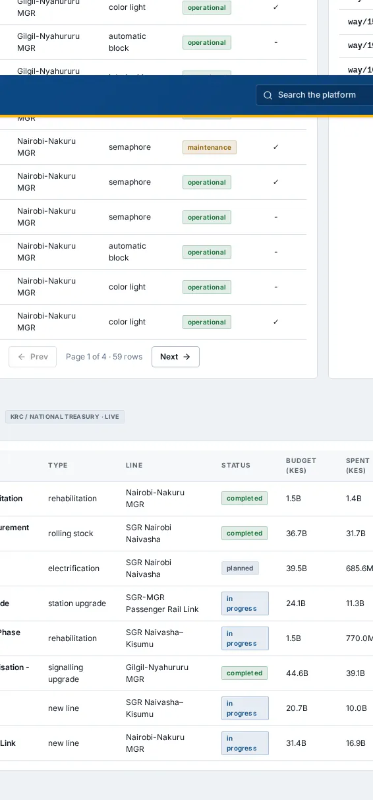
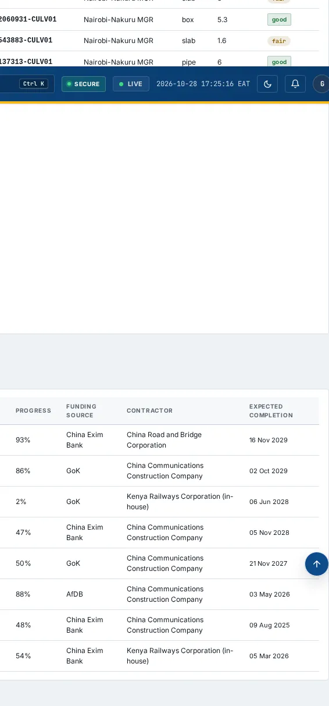

# Rail Infrastructure

_Railway › Rail Infrastructure_ · Route `/railway/infrastructure`

**Rail Infrastructure** lets you see track section condition, level crossings, signalling, culverts, and the capital works pipeline. Data on this page comes from KRC.

> 🎬 **Video tutorial:** _coming soon._  
> <!-- VIDEO-URL: railway/rail-infrastructure | paste the link here, e.g. [Watch the walkthrough](https://…) -->

## Highlights

- **7 headline tiles** — Operational Track, Sections Needing Repair, Signal Availability, Crossings Needing Action, Culverts Poor / Critical, Open Capital Works….
- **5 panels** — Track Sections, Level Crossings, Signalling, Culverts, Capital Works Pipeline.
- **Refreshes itself every 120 seconds**, so you do not need to reload the page.
- **Filters and search** to narrow tables to what you need.
- Every figure is traceable to the data feed or upload template that supplies it — see [Data sources and feeds](#data-sources-and-feeds).

## Enabling and access

1. Sign in to UAPTS (see [How to access](../getting-started/how-to-access.md)).
2. In the left sidebar expand **Railway** and click **Rail Infrastructure**.
3. The page opens at `/railway/infrastructure`. You can also reach it with the global search (**Ctrl + K**).

This page belongs to module **M08 · Railway**. The sidebar and the global search only list pages your agency and role can open, and a link to a page you cannot reach sends you back to the Command Centre. If a page you expect is missing, ask your agency administrator to check your agency's [Module Access](../access-control/module-access.md).

## Page tour

### Headline tiles

| Tile | What it shows | Data from | Table → ingested via |
|---|---|---|---|
| **Operational Track** | — _(window: LIVE)_ | `/railway/lines/` | _RailLine_ → no template yet |
| **Sections Needing Repair** | — _(window: LIVE)_ | `/railway/track-sections/` | _RailTrackSection_ → [`krc-rail-track-section-register`](../data-templates/krc-rail-track-section-register.xlsx) |
| **Signal Availability** | — _(window: LIVE)_ | `/railway/signals/` | _RailSignal_ → [`krc-rail-signal-register`](../data-templates/krc-rail-signal-register.xlsx) |
| **Crossings Needing Action** | High / critical risk rating _(window: LIVE)_ | `/railway/level-crossings/` | _LevelCrossing_ → [`krc-rail-level-crossing-register`](../data-templates/krc-rail-level-crossing-register.xlsx) |
| **Culverts Poor / Critical** | — _(window: LIVE)_ | `/railway/culverts/` | _RailCulvert_ → [`krc-rail-culvert-register`](../data-templates/krc-rail-culvert-register.xlsx) |
| **Open Capital Works** | — _(window: LIVE)_ | `/railway/capital-works/` | _RailCapitalWorksProject_ → [`krc-rail-capital-works`](../data-templates/krc-rail-capital-works.xlsx) |
| **Capital Works Budget** | Sum of active project budgets _(window: LIVE)_ | `/railway/capital-works/` | _RailCapitalWorksProject_ → [`krc-rail-capital-works`](../data-templates/krc-rail-capital-works.xlsx) |

### Track Sections

Contains a table with the columns **Line**, **Section**, **Chainage (km)**, **Rail Type**, **Sleeper**, **Condition**, **Posted Speed**, **Last Inspected**, **Next Inspection Due**.

**Data from:** `/railway/level-crossings/`, `/railway/track-sections/`  
**Table → ingested via:** _LevelCrossing, RailTrackSection_ → [`krc-rail-level-crossing-register`](../data-templates/krc-rail-level-crossing-register.xlsx) [`krc-rail-track-section-register`](../data-templates/krc-rail-track-section-register.xlsx)

### Level Crossings

Contains a table with the columns **Crossing**, **Road**, **Line**, **Protection**, **Risk**, **Near-Misses**, **Daily Road Traffic**, **Daily Trains**, **Last Incident**, **Active**.

**Data from:** `/railway/level-crossings/`  
**Table → ingested via:** _LevelCrossing_ → [`krc-rail-level-crossing-register`](../data-templates/krc-rail-level-crossing-register.xlsx)

### Signalling

Contains a table with the columns **Signal**, **Line**, **Type**, **Status**, **Automatic**.

**Data from:** `/railway/culverts/`, `/railway/signals/`  
**Table → ingested via:** _RailCulvert, RailSignal_ → [`krc-rail-culvert-register`](../data-templates/krc-rail-culvert-register.xlsx) [`krc-rail-signal-register`](../data-templates/krc-rail-signal-register.xlsx)

### Culverts

Contains a table with the columns **Culvert**, **Line**, **Type**, **Span (m)**, **Condition**.

**Data from:** `/railway/culverts/`  
**Table → ingested via:** _RailCulvert_ → [`krc-rail-culvert-register`](../data-templates/krc-rail-culvert-register.xlsx)

### Capital Works Pipeline

Contains a table with the columns **Project**, **Type**, **Line**, **Status**, **Budget (KES)**, **Spent (KES)**, **Progress**, **Funding Source**, **Contractor**, **Expected Completion**.

**Data from:** `/railway/capital-works/`  
**Table → ingested via:** _RailCapitalWorksProject_ → [`krc-rail-capital-works`](../data-templates/krc-rail-capital-works.xlsx)

## Working with this page

1. Open **Railway → Rail Infrastructure** from the sidebar.
2. Wait for the page to finish loading. It re-fetches its data every **120 s**; the figures you see are the latest the platform holds, not a one-time snapshot.
3. Type in the **“Search road / line…”** box to filter what is shown.
4. Type in the **“Search section / line…”** box to filter what is shown.
5. Use the **All conditions** drop-down to narrow the list. Choices include: Excellent, Good, Fair, Poor, Critical.
6. Use the **All risk ratings** drop-down to narrow the list. Choices include: Critical, High, Medium, Low.

## Status and value meanings

These are the values the platform stores for the fields shown on this page (`value` followed by the label you see).

| Field | Table | Values |
|---|---|---|
| project type | RailCapitalWorksProject | `new_line` New line construction · `electrification` · `rehabilitation` Track rehabilitation · `station_upgrade` · `signalling_upgrade` · `rolling_stock` Rolling stock procurement |
| status | RailCapitalWorksProject | `planned` · `in_progress` · `completed` · `suspended` |
| culvert type | RailCulvert | `box` Box culvert · `pipe` Pipe culvert · `arch` Arch culvert · `slab` Slab culvert |
| condition | RailCulvert | `good` · `fair` · `poor` · `critical` |
| protection type | LevelCrossing | `gated_manual` Gated - manually operated · `gated_automatic` Gated - automatic barrier · `lights_only` Flashing lights, no barrier · `unguarded` Unguarded / whistle board only |
| status | RailLine | `operational` · `under_construction` · `planned` · `suspended` Service suspended · `abandoned` · `decommissioned` |
| signal type | RailSignal | `color_light` Colour light · `semaphore` · `interlocking` Interlocking / points · `automatic_block` |
| status | RailSignal | `operational` · `faulty` · `maintenance` Under maintenance · `decommissioned` |
| rail type | RailTrackSection | `welded` Continuous welded rail · `jointed` Jointed rail |

## Data sources and feeds

Every number and table on this page is read from the API endpoints below. The **Ingested via** column says how the underlying records get into UAPTS: a downloadable **upload template** (xlsx/CSV, loaded through the [Integration Hub](../integration-hub/upload-and-connect.md)), a **live feed** that pushes records to the ingest API, or — where neither exists yet — it is stated plainly.

| Endpoint | Records | Ingested via |
|---|---|---|
| `GET /railway/capital-works/` | Rail Capital Works Projects | [`krc-rail-capital-works`](../data-templates/krc-rail-capital-works.xlsx) |
| `GET /railway/culverts/` | Rail Culverts | [`krc-rail-culvert-register`](../data-templates/krc-rail-culvert-register.xlsx) |
| `GET /railway/level-crossings/` | Level Crossings | [`krc-rail-level-crossing-register`](../data-templates/krc-rail-level-crossing-register.xlsx) |
| `GET /railway/lines/` | Rail Lines | **No ingestion template yet** — populated by seed data or direct entry |
| `GET /railway/signals/` | Rail Signals | [`krc-rail-signal-register`](../data-templates/krc-rail-signal-register.xlsx) |
| `GET /railway/track-sections/` | Rail Track Sections | [`krc-rail-track-section-register`](../data-templates/krc-rail-track-section-register.xlsx) |

Full details of every template (columns, formats) are in the [Data sources catalogue](../reference/data-sources.md). Interactive API documentation is available at `/api/docs/`.

## Permissions

| Who | What they can do here |
|---|---|
| Public / read-only accounts | View the page where the module is enabled for their agency (read-only). |
| Operator | View the page. |
| Analyst | View and **export CSV**. |
| Agency admin | Everything an analyst can do, plus the administrative capabilities listed in [Roles & Permissions](../access-control/roles-and-permissions.md). |
| Super admin | Sees every agency's data. |

**Agencies with the Railway module:** full — SDT, KRC; selected pages only — KENHA, NAMATA, KPA, NCTTCA, LAPSSET.

_Access is evaluated by the server from the baseline policy plus any agency overrides, so a super admin or agency admin may have changed it from the defaults above._

## Related topics

- [Railway Overview](railway-overview.md)
- [Train Operations](train-operations.md)
- [Freight Volumes](freight-volumes.md)
- [Schedules](schedules.md)
- [Rail Network Inventory](rail-network-inventory.md)
- [Rail Safety](rail-safety.md)
- [Railway overview](index.md)
- [Upload & Connect (Integration Hub)](../integration-hub/upload-and-connect.md)
- [Data sources catalogue](../reference/data-sources.md)

## On this page

- [Highlights](#highlights)
- [Enabling and access](#enabling-and-access)
- [Page tour](#page-tour)
- [Working with this page](#working-with-this-page)
- [Status and value meanings](#status-and-value-meanings)
- [Data sources and feeds](#data-sources-and-feeds)
- [Permissions](#permissions)
- [Related topics](#related-topics)

## Support

- **Your agency administrator** is the first contact for access, role and data-quality questions.
- **Data feeds, templates and API questions:** `api-support@uapts.go.ke` (include the `X-Request-ID` response header from a failing call).
- **Security concerns:** `security@uapts.go.ke`. Do not report suspected vulnerabilities publicly.
