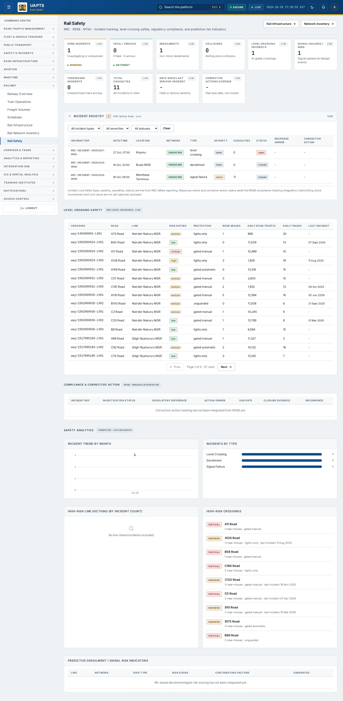
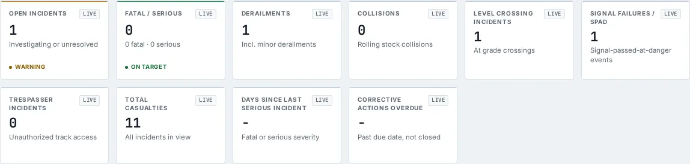
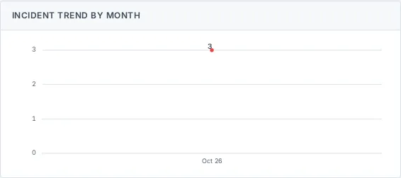
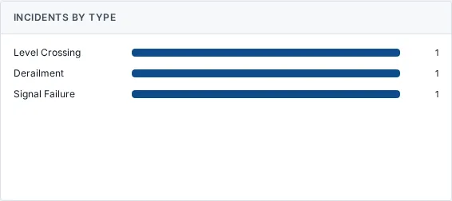
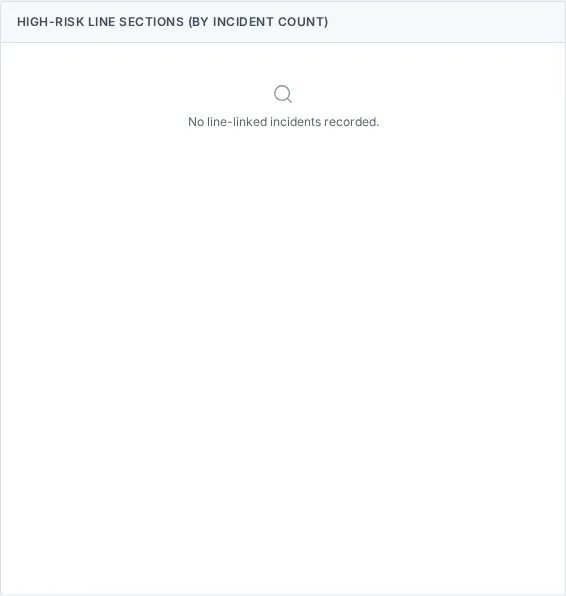
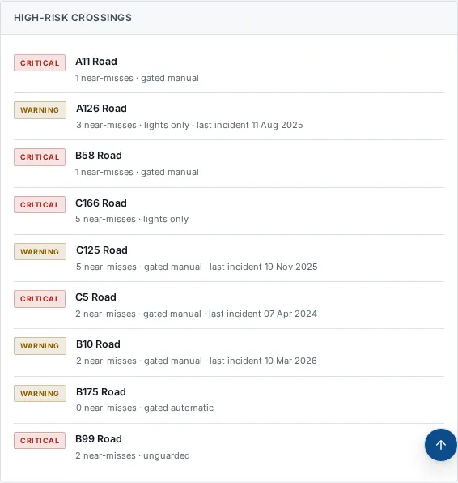
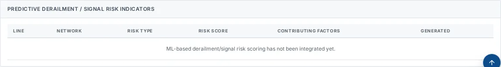

# Rail Safety

_Railway › Rail Safety_ · Route `/railway/safety`

**Rail Safety** lets you see incident tracking, level crossing safety, regulatory compliance, and predictive risk indicators. Data on this page comes from KRC, RSSB and NTSA.

> 🎬 **Video tutorial:** _coming soon._  
> <!-- VIDEO-URL: railway/rail-safety | paste the link here, e.g. [Watch the walkthrough](https://…) -->

## Highlights

- **10 headline tiles** — Open Incidents, Fatal / Serious, Derailments, Collisions, Level Crossing Incidents, Signal Failures / SPAD….
- **7 panels** — Level Crossing Safety, Compliance &amp; Corrective Action, Incident Trend by Month, Incidents by Type, High-Risk Line Sections (by incident count), High-Risk Crossings….
- **Refreshes itself every 120 seconds**, so you do not need to reload the page.
- **Filters and search** to narrow tables to what you need.
- Every figure is traceable to the data feed or upload template that supplies it — see [Data sources and feeds](#data-sources-and-feeds).

## Enabling and access

1. Sign in to UAPTS (see [How to access](../getting-started/how-to-access.md)).
2. In the left sidebar expand **Railway** and click **Rail Safety**.
3. The page opens at `/railway/safety`. You can also reach it with the global search (**Ctrl + K**).

This page belongs to module **M08 · Railway**. The sidebar and the global search only list pages your agency and role can open, and a link to a page you cannot reach sends you back to the Command Centre. If a page you expect is missing, ask your agency administrator to check your agency's [Module Access](../access-control/module-access.md).

## Page tour

### Headline tiles

| Tile | What it shows | Data from | Table → ingested via |
|---|---|---|---|
| **Open Incidents** | Investigating or unresolved _(window: LIVE)_ | `/railway/incidents/` | _RailIncident_ → [`krc-rail-incident-log`](../data-templates/krc-rail-incident-log.xlsx) |
| **Fatal / Serious** | — _(window: LIVE)_ | — | — |
| **Derailments** | Incl. minor derailments _(window: LIVE)_ | — | — |
| **Collisions** | Rolling stock collisions _(window: LIVE)_ | — | — |
| **Level Crossing Incidents** | At grade crossings _(window: LIVE)_ | — | — |
| **Signal Failures / SPAD** | Signal-passed-at-danger events _(window: LIVE)_ | — | — |
| **Trespasser Incidents** | Unauthorized track access _(window: LIVE)_ | — | — |
| **Total Casualties** | All incidents in view _(window: LIVE)_ | `/railway/incidents/` | _RailIncident_ → [`krc-rail-incident-log`](../data-templates/krc-rail-incident-log.xlsx) |
| **Days Since Last Serious Incident** | Fatal or serious severity _(window: LIVE)_ | `/railway/incidents/` | _RailIncident_ → [`krc-rail-incident-log`](../data-templates/krc-rail-incident-log.xlsx) |
| **Corrective Actions Overdue** | Past due date, not closed _(window: LIVE)_ | `/railway/safety/corrective-actions/` | _RailCorrectiveAction_ → no template yet |

### Level Crossing Safety

Contains a table with the columns **Crossing**, **Road**, **Line**, **Risk Rating**, **Protection**, **Near Misses**, **Daily Road Traffic**, **Daily Trains**, **Last Incident**.

**Data from:** `/railway/level-crossings/`  
**Table → ingested via:** _LevelCrossing_ → [`krc-rail-level-crossing-register`](../data-templates/krc-rail-level-crossing-register.xlsx)

### Compliance &amp; Corrective Action

Contains a table with the columns **Incident Ref**, **Investigation Status**, **Regulatory Reference**, **Action Owner**, **Due Date**, **Closure Evidence**, **Recurrence**.

**Data from:** `/railway/safety/corrective-actions/`  
**Table → ingested via:** _RailCorrectiveAction_ → no template yet

### Incident Trend by Month

Contains a chart.

**Data from:** `/railway/incidents/`  
**Table → ingested via:** _RailIncident_ → [`krc-rail-incident-log`](../data-templates/krc-rail-incident-log.xlsx)

### Incidents by Type

**Data from:** `/railway/incidents/`  
**Table → ingested via:** _RailIncident_ → [`krc-rail-incident-log`](../data-templates/krc-rail-incident-log.xlsx)

### High-Risk Line Sections (by incident count)

**Data from:** `/railway/incidents/`, `/railway/lines/`  
**Table → ingested via:** _RailIncident, RailLine_ → [`krc-rail-incident-log`](../data-templates/krc-rail-incident-log.xlsx)

### High-Risk Crossings

**Data from:** `/railway/level-crossings/`  
**Table → ingested via:** _LevelCrossing_ → [`krc-rail-level-crossing-register`](../data-templates/krc-rail-level-crossing-register.xlsx)

### Predictive Derailment / Signal Risk Indicators

Contains a table with the columns **Line**, **Network**, **Risk Type**, **Risk Score**, **Contributing Factors**, **Generated**.

**Data from:** `/railway/safety/risk-indicators/`  
**Table → ingested via:** _RailRiskIndicator_ → no template yet

## Working with this page

1. Open **Railway → Rail Safety** from the sidebar.
2. Wait for the page to finish loading. It re-fetches its data every **120 s**; the figures you see are the latest the platform holds, not a one-time snapshot.
3. Use the **All incident types** drop-down to narrow the list. Choices include: Collision, Derailment, Minor Derailment, Level Crossing, Fire, Passenger.
4. Use the **All severities** drop-down to narrow the list. Choices include: Fatal, Serious, Minor, None.
5. Use the **All statuses** drop-down to narrow the list. Choices include: Open, Investigating, Resolved, Closed.

## Status and value meanings

These are the values the platform stores for the fields shown on this page (`value` followed by the label you see).

| Field | Table | Values |
|---|---|---|
| incident type | RailIncident | `collision` Train collision · `derailment` · `level_crossing` Level-crossing accident · `fire` On-board fire · `passenger` Passenger incident · `trespasser` Trespasser fatality · `signal_failure` Signal failure (no casualty) · `derailment_minor` Minor derailment |
| severity | RailIncident | `fatal` Fatality · `serious` Serious injury · `minor` Minor injury · `none` No injury |
| status | RailIncident | `open` · `investigating` · `resolved` · `closed` |
| protection type | LevelCrossing | `gated_manual` Gated - manually operated · `gated_automatic` Gated - automatic barrier · `lights_only` Flashing lights, no barrier · `unguarded` Unguarded / whistle board only |
| status | RailLine | `operational` · `under_construction` · `planned` · `suspended` Service suspended · `abandoned` · `decommissioned` |
| investigation status | RailCorrectiveAction | `open` · `in_progress` · `closed` |
| risk type | RailRiskIndicator | `derailment` · `signal_failure` |

## Data sources and feeds

Every number and table on this page is read from the API endpoints below. The **Ingested via** column says how the underlying records get into UAPTS: a downloadable **upload template** (xlsx/CSV, loaded through the [Integration Hub](../integration-hub/upload-and-connect.md)), a **live feed** that pushes records to the ingest API, or — where neither exists yet — it is stated plainly.

| Endpoint | Records | Ingested via |
|---|---|---|
| `GET /railway/incidents/` | Rail Incidents | [`krc-rail-incident-log`](../data-templates/krc-rail-incident-log.xlsx) |
| `GET /railway/level-crossings/` | Level Crossings | [`krc-rail-level-crossing-register`](../data-templates/krc-rail-level-crossing-register.xlsx) |
| `GET /railway/lines/` | Rail Lines | **No ingestion template yet** — populated by seed data or direct entry |
| `GET /railway/safety/corrective-actions/` | Rail Corrective Actions | **No ingestion template yet** — populated by seed data or direct entry |
| `GET /railway/safety/risk-indicators/` | Rail Risk Indicators | **No ingestion template yet** — populated by seed data or direct entry |

Full details of every template (columns, formats) are in the [Data sources catalogue](../reference/data-sources.md). Interactive API documentation is available at `/api/docs/`.

## Permissions

| Who | What they can do here |
|---|---|
| Public / read-only accounts | View the page where the module is enabled for their agency (read-only). |
| Operator | View the page. |
| Analyst | View and **export CSV**. |
| Agency admin | Everything an analyst can do, plus the administrative capabilities listed in [Roles & Permissions](../access-control/roles-and-permissions.md). |
| Super admin | Sees every agency's data. |

**Agencies with the Railway module:** full — SDT, KRC; selected pages only — KENHA, NAMATA, KPA, NCTTCA, LAPSSET.

_Access is evaluated by the server from the baseline policy plus any agency overrides, so a super admin or agency admin may have changed it from the defaults above._

## Related topics

- [Railway Overview](railway-overview.md)
- [Train Operations](train-operations.md)
- [Freight Volumes](freight-volumes.md)
- [Schedules](schedules.md)
- [Rail Infrastructure](rail-infrastructure.md)
- [Rail Network Inventory](rail-network-inventory.md)
- [Railway overview](index.md)
- [Upload & Connect (Integration Hub)](../integration-hub/upload-and-connect.md)
- [Data sources catalogue](../reference/data-sources.md)

## On this page

- [Highlights](#highlights)
- [Enabling and access](#enabling-and-access)
- [Page tour](#page-tour)
- [Working with this page](#working-with-this-page)
- [Status and value meanings](#status-and-value-meanings)
- [Data sources and feeds](#data-sources-and-feeds)
- [Permissions](#permissions)
- [Related topics](#related-topics)

## Support

- **Your agency administrator** is the first contact for access, role and data-quality questions.
- **Data feeds, templates and API questions:** `api-support@uapts.go.ke` (include the `X-Request-ID` response header from a failing call).
- **Security concerns:** `security@uapts.go.ke`. Do not report suspected vulnerabilities publicly.
