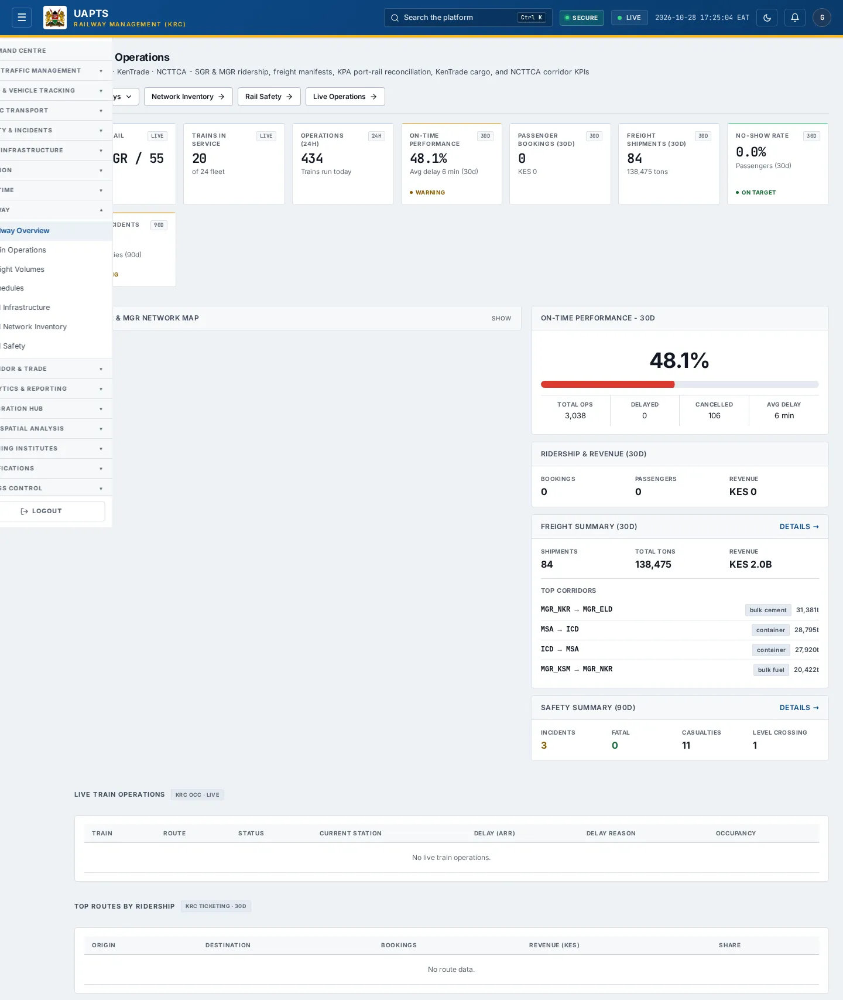
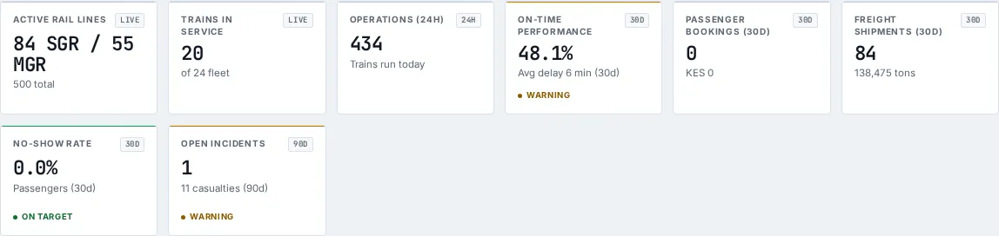
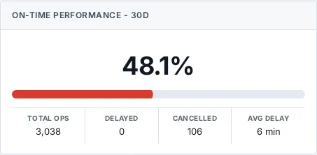
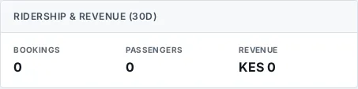
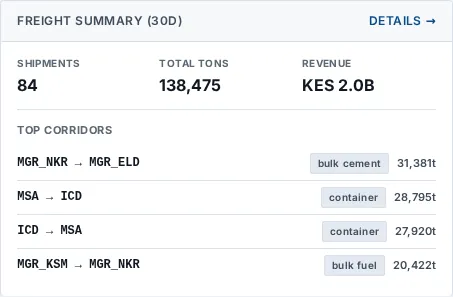
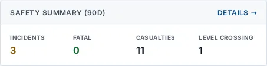

# Railway Overview

_Railway › Railway Overview_ · Route `/railway`

**Railway Operations** lets you see SGR & MGR ridership, freight manifests, KPA port-rail reconciliation, KenTrade cargo, and NCTTCA corridor KPIs. Data on this page comes from KRC, KPA, KenTrade and NCTTCA.

> 🎬 **Video tutorial:** _coming soon._  
> <!-- VIDEO-URL: railway/railway-overview | paste the link here, e.g. [Watch the walkthrough](https://…) -->

## Highlights

- **8 headline tiles** — Active Rail Lines, Trains in Service, Operations (24h), On-Time Performance, Passenger Bookings (30d), Freight Shipments (30d)….
- **6 panels** — On-Time Performance -, Ridership & Revenue (30d), Freight Summary (30d), Safety Summary (90d), Live Train Operations, Top Routes by Ridership.
- An **interactive map** with a legend, full-screen, locate-me and base-map controls.
- **Refreshes itself every 120 seconds**, so you do not need to reload the page.
- Every figure is traceable to the data feed or upload template that supplies it — see [Data sources and feeds](#data-sources-and-feeds).

## Enabling and access

1. Sign in to UAPTS (see [How to access](../getting-started/how-to-access.md)).
2. In the left sidebar expand **Railway** and click **Railway Overview**.
3. The page opens at `/railway`. You can also reach it with the global search (**Ctrl + K**).

This page belongs to module **M08 · Railway**. The sidebar and the global search only list pages your agency and role can open, and a link to a page you cannot reach sends you back to the Command Centre. If a page you expect is missing, ask your agency administrator to check your agency's [Module Access](../access-control/module-access.md).

## Page tour

### Headline tiles

| Tile | What it shows | Data from | Table → ingested via |
|---|---|---|---|
| **Active Rail Lines** | — _(window: LIVE)_ | `/railway/summary/` | _RailLine_ → no template yet |
| **Trains in Service** | — _(window: LIVE)_ | `/railway/summary/` | _Train, TrainOperation, TrainSchedule_ → [`krc-train-register`](../data-templates/krc-train-register.xlsx) [`krc-train-schedule-register`](../data-templates/krc-train-schedule-register.xlsx) |
| **Operations (24h)** | Trains run today _(window: 24H)_ | `/railway/summary/` | _TrainOperation_ → no template yet |
| **On-Time Performance** | — _(window: 30D)_ | `/railway/operations/on-time-stats/`, `/railway/summary/` | _TrainOperation_ → no template yet |
| **Passenger Bookings (30d)** | — _(window: 30D)_ | `/railway/summary/` | aggregate of several tables — see [per-table feeds](#data-sources-and-feeds) |
| **Freight Shipments (30d)** | — _(window: 30D)_ | `/railway/summary/` | _FreightManifest_ → no template yet |
| **No-Show Rate** | Passengers (30d) _(window: 30D)_ | `/railway/summary/` | aggregate of several tables — see [per-table feeds](#data-sources-and-feeds) |
| **Open Incidents** | — _(window: 90D)_ | `/railway/summary/` | _RailIncident_ → [`krc-rail-incident-log`](../data-templates/krc-rail-incident-log.xlsx) |

### On-Time Performance -

**Data from:** `/railway/operations/on-time-stats/`, `/railway/summary/`  
**Table → ingested via:** _TrainOperation_ → no template yet

### Ridership & Revenue (30d)

**Data from:** `/railway/summary/`  
**Table → ingested via:** _RailRidershipDaily_ → [`krc-rail-ridership-daily`](../data-templates/krc-rail-ridership-daily.xlsx)

### Freight Summary (30d)

**Data from:** `/railway/summary/`  
**Table → ingested via:** _FreightManifest_ → no template yet

### Safety Summary (90d)

**Data from:** `/railway/summary/`  
**Table → ingested via:** aggregate of several tables — see [per-table feeds](#data-sources-and-feeds)

### Live Train Operations

Contains a table with the columns **Train**, **Route**, **Status**, **Current Station**, **Delay (Arr)**, **Delay Reason**, **Occupancy**.

**Data from:** `/railway/summary/`  
**Table → ingested via:** _TrainOperation_ → no template yet

### Top Routes by Ridership

Contains a table with the columns **Origin**, **Destination**, **Bookings**, **Revenue (KES)**, **Share**.

**Data from:** `/railway/summary/`  
**Table → ingested via:** _RailRidershipDaily_ → [`krc-rail-ridership-daily`](../data-templates/krc-rail-ridership-daily.xlsx)

## Working with this page

1. Open **Railway → Railway Overview** from the sidebar.
2. Wait for the page to finish loading. It re-fetches its data every **120 s**; the figures you see are the latest the platform holds, not a one-time snapshot.
3. On the map, drag to pan and scroll (or pinch) to zoom. Click a marker or line for its details. Use the map toolbar to go full-screen, centre on your location, reset the view or switch the base map; click the legend chip to expand it.

## Status and value meanings

These are the values the platform stores for the fields shown on this page (`value` followed by the label you see).

| Field | Table | Values |
|---|---|---|
| status | TrainOperation | `scheduled` · `boarding` · `departed` · `in_transit` · `arrived` · `delayed` · `cancelled` · `diverted` |

## Data sources and feeds

Every number and table on this page is read from the API endpoints below. The **Ingested via** column says how the underlying records get into UAPTS: a downloadable **upload template** (xlsx/CSV, loaded through the [Integration Hub](../integration-hub/upload-and-connect.md)), a **live feed** that pushes records to the ingest API, or — where neither exists yet — it is stated plainly.

| Endpoint | Records | Ingested via |
|---|---|---|
| `GET /geojson/rail-lines/` | _Aggregate of 1 tables (rows below)_ | — |
| ↳ RailLine | Rail Lines | **No ingestion template yet** — populated by seed data or direct entry |
| `GET /geojson/rail-stations/` | _Aggregate of 1 tables (rows below)_ | — |
| ↳ RailStation | Rail Stations | [`krc-rail-station-register`](../data-templates/krc-rail-station-register.xlsx) |
| `GET /railway/operations/live/` | Train Operations | **No ingestion template yet** — populated by seed data or direct entry |
| `GET /railway/operations/on-time-stats/` | Train Operations | **No ingestion template yet** — populated by seed data or direct entry |
| `GET /railway/summary/` | _Aggregate of 10 tables (rows below)_ | — |
| ↳ Schedule | Schedules | **No ingestion template yet** — populated by seed data or direct entry |
| ↳ FreightManifest | Freight Manifests | **No ingestion template yet** — populated by seed data or direct entry |
| ↳ RailIncident | Rail Incidents | [`krc-rail-incident-log`](../data-templates/krc-rail-incident-log.xlsx) |
| ↳ RailLine | Rail Lines | **No ingestion template yet** — populated by seed data or direct entry |
| ↳ RailRidershipDaily | Rail Ridership Dailys | [`krc-rail-ridership-daily`](../data-templates/krc-rail-ridership-daily.xlsx) |
| ↳ RailStation | Rail Stations | [`krc-rail-station-register`](../data-templates/krc-rail-station-register.xlsx) |
| ↳ RailTicket | Rail Tickets | **No ingestion template yet** — populated by seed data or direct entry |
| ↳ Train | Trains | [`krc-train-register`](../data-templates/krc-train-register.xlsx) |
| ↳ TrainOperation | Train Operations | **No ingestion template yet** — populated by seed data or direct entry |
| ↳ TrainSchedule | Train Schedules | [`krc-train-schedule-register`](../data-templates/krc-train-schedule-register.xlsx) |

Full details of every template (columns, formats) are in the [Data sources catalogue](../reference/data-sources.md). Interactive API documentation is available at `/api/docs/`.

## Permissions

| Who | What they can do here |
|---|---|
| Public / read-only accounts | View the page where the module is enabled for their agency (read-only). |
| Operator | View the page. |
| Analyst | View and **export CSV**. |
| Agency admin | Everything an analyst can do, plus the administrative capabilities listed in [Roles & Permissions](../access-control/roles-and-permissions.md). |
| Super admin | Sees every agency's data. |

**Agencies with the Railway module:** full — SDT, KRC; selected pages only — KENHA, NAMATA, KPA, NCTTCA, LAPSSET.

_Access is evaluated by the server from the baseline policy plus any agency overrides, so a super admin or agency admin may have changed it from the defaults above._

## Related topics

- [Train Operations](train-operations.md)
- [Freight Volumes](freight-volumes.md)
- [Schedules](schedules.md)
- [Rail Infrastructure](rail-infrastructure.md)
- [Rail Network Inventory](rail-network-inventory.md)
- [Rail Safety](rail-safety.md)
- [Railway overview](index.md)
- [Upload & Connect (Integration Hub)](../integration-hub/upload-and-connect.md)
- [Data sources catalogue](../reference/data-sources.md)

## On this page

- [Highlights](#highlights)
- [Enabling and access](#enabling-and-access)
- [Page tour](#page-tour)
- [Working with this page](#working-with-this-page)
- [Status and value meanings](#status-and-value-meanings)
- [Data sources and feeds](#data-sources-and-feeds)
- [Permissions](#permissions)
- [Related topics](#related-topics)

## Support

- **Your agency administrator** is the first contact for access, role and data-quality questions.
- **Data feeds, templates and API questions:** `api-support@uapts.go.ke` (include the `X-Request-ID` response header from a failing call).
- **Security concerns:** `security@uapts.go.ke`. Do not report suspected vulnerabilities publicly.
