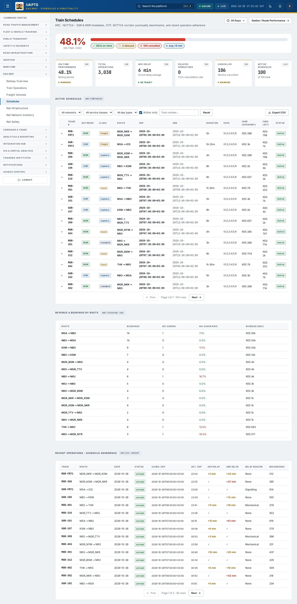
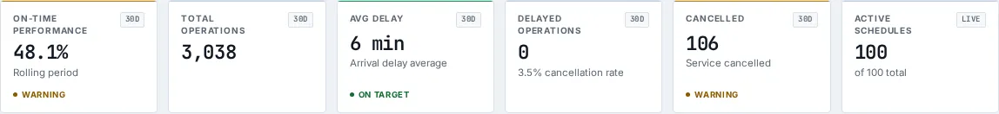

# Schedules

_Railway › Schedules_ · Route `/railway/schedules`

**Train Schedules** lets you see SGR &amp; MGR timetables, OTP, NCTTCA corridor punctuality benchmarks, and recent operation adherence. Data on this page comes from KRC and NCTTCA.

> 🎬 **Video tutorial:** _coming soon._  
> <!-- VIDEO-URL: railway/schedules | paste the link here, e.g. [Watch the walkthrough](https://…) -->

## Highlights

- **6 headline tiles** — On-Time Performance, Total Operations, Avg Delay, Delayed Operations, Cancelled, Active Schedules.
- **3 panels** — Active Schedules, Revenue &amp; Bookings by Route, Recent Operations - Schedule Adherence.
- **Refreshes itself every 120 seconds**, so you do not need to reload the page.
- **Export to CSV** for the rows you are looking at (Analyst tier and above).
- **Filters and search** to narrow tables to what you need.
- Every figure is traceable to the data feed or upload template that supplies it — see [Data sources and feeds](#data-sources-and-feeds).

## Enabling and access

1. Sign in to UAPTS (see [How to access](../getting-started/how-to-access.md)).
2. In the left sidebar expand **Railway** and click **Schedules**.
3. The page opens at `/railway/schedules`. You can also reach it with the global search (**Ctrl + K**).

This page belongs to module **M08 · Railway**. The sidebar and the global search only list pages your agency and role can open, and a link to a page you cannot reach sends you back to the Command Centre. If a page you expect is missing, ask your agency administrator to check your agency's [Module Access](../access-control/module-access.md).

## Page tour

### Headline tiles

| Tile | What it shows | Data from | Table → ingested via |
|---|---|---|---|
| **On-Time Performance** | Rolling period | `/railway/operations/on-time-stats/` | _TrainOperation_ → no template yet |
| **Total Operations** | — | `/railway/operations/on-time-stats/` | _TrainOperation_ → no template yet |
| **Avg Delay** | Arrival delay average | `/railway/operations/on-time-stats/` | _TrainOperation_ → no template yet |
| **Delayed Operations** | — | `/railway/operations/on-time-stats/` | _TrainOperation_ → no template yet |
| **Cancelled** | Service cancelled | `/railway/operations/on-time-stats/` | _TrainOperation_ → no template yet |
| **Active Schedules** | — _(window: LIVE)_ | `/railway/schedules/` | _TrainSchedule_ → [`krc-train-schedule-register`](../data-templates/krc-train-schedule-register.xlsx) |

### Active Schedules

Contains a table with the columns **Train #**, **Network**, **Class**, **Route**, **Dep**, **Arr**, **Duration**, **Days**, **Fare (Economy)**, **Fare (1st)**, **Status**.

**Data from:** `/railway/schedules/`  
**Table → ingested via:** _TrainSchedule_ → [`krc-train-schedule-register`](../data-templates/krc-train-schedule-register.xlsx)

### Revenue &amp; Bookings by Route

Contains a table with the columns **Route**, **Bookings**, **No-Shows**, **No-Show Rate**, **Revenue (KES)**.

**Data from:** `/railway/tickets/`  
**Table → ingested via:** _RailTicket_ → no template yet

### Recent Operations - Schedule Adherence

Contains a table with the columns **Train**, **Route**, **Date**, **Status**, **Sched. Dep**, **Act. Dep**, **Dep Delay**, **Arr Delay**, **Delay Reason**, **Passengers**.

**Data from:** `/railway/operations/`  
**Table → ingested via:** _TrainOperation_ → no template yet

## Working with this page

1. Open **Railway → Schedules** from the sidebar.
2. Wait for the page to finish loading. It re-fetches its data every **120 s**; the figures you see are the latest the platform holds, not a one-time snapshot.
3. Type in the **“Train number…”** box to filter what is shown.
4. Use the **All networks** drop-down to narrow the list. Choices include: SGR, MGR.
5. Use the **All service classes** drop-down to narrow the list. Choices include: Express, Standard, Local, Freight.
6. Use the **All day types** drop-down to narrow the list. Choices include: Daily, Weekday, Weekend, Holiday.
7. Click a row to open its detail.
8. Click **Export CSV** to download the rows currently loaded (after filters). The button only appears for Analyst tier and above.

## Status and value meanings

These are the values the platform stores for the fields shown on this page (`value` followed by the label you see).

| Field | Table | Values |
|---|---|---|
| status | TrainOperation | `scheduled` · `boarding` · `departed` · `in_transit` · `arrived` · `delayed` · `cancelled` · `diverted` |
| service class | TrainSchedule | `express` · `standard` · `local` · `freight` Freight only |
| day type | TrainSchedule | `weekday` · `weekend` · `holiday` Public holiday · `daily` |

## Data sources and feeds

Every number and table on this page is read from the API endpoints below. The **Ingested via** column says how the underlying records get into UAPTS: a downloadable **upload template** (xlsx/CSV, loaded through the [Integration Hub](../integration-hub/upload-and-connect.md)), a **live feed** that pushes records to the ingest API, or — where neither exists yet — it is stated plainly.

| Endpoint | Records | Ingested via |
|---|---|---|
| `GET /railway/operations/` | Train Operations | **No ingestion template yet** — populated by seed data or direct entry |
| `GET /railway/operations/on-time-stats/` | Train Operations | **No ingestion template yet** — populated by seed data or direct entry |
| `GET /railway/schedules/` | Train Schedules | [`krc-train-schedule-register`](../data-templates/krc-train-schedule-register.xlsx) |
| `GET /railway/tickets/` | Rail Tickets | **No ingestion template yet** — populated by seed data or direct entry |

Full details of every template (columns, formats) are in the [Data sources catalogue](../reference/data-sources.md). Interactive API documentation is available at `/api/docs/`.

## Permissions

| Who | What they can do here |
|---|---|
| Public / read-only accounts | View the page where the module is enabled for their agency (read-only). |
| Operator | View the page. |
| Analyst | View and **export CSV**. |
| Agency admin | Everything an analyst can do, plus the administrative capabilities listed in [Roles & Permissions](../access-control/roles-and-permissions.md). |
| Super admin | Sees every agency's data. |

**Agencies with the Railway module:** full — SDT, KRC; selected pages only — KENHA, NAMATA, KPA, NCTTCA, LAPSSET.

_Access is evaluated by the server from the baseline policy plus any agency overrides, so a super admin or agency admin may have changed it from the defaults above._

## Related topics

- [Railway Overview](railway-overview.md)
- [Train Operations](train-operations.md)
- [Freight Volumes](freight-volumes.md)
- [Rail Infrastructure](rail-infrastructure.md)
- [Rail Network Inventory](rail-network-inventory.md)
- [Rail Safety](rail-safety.md)
- [Railway overview](index.md)
- [Upload & Connect (Integration Hub)](../integration-hub/upload-and-connect.md)
- [Data sources catalogue](../reference/data-sources.md)

## On this page

- [Highlights](#highlights)
- [Enabling and access](#enabling-and-access)
- [Page tour](#page-tour)
- [Working with this page](#working-with-this-page)
- [Status and value meanings](#status-and-value-meanings)
- [Data sources and feeds](#data-sources-and-feeds)
- [Permissions](#permissions)
- [Related topics](#related-topics)

## Support

- **Your agency administrator** is the first contact for access, role and data-quality questions.
- **Data feeds, templates and API questions:** `api-support@uapts.go.ke` (include the `X-Request-ID` response header from a failing call).
- **Security concerns:** `security@uapts.go.ke`. Do not report suspected vulnerabilities publicly.
