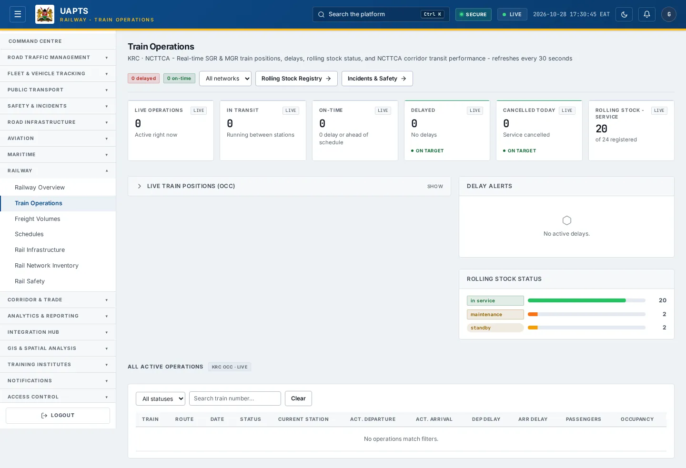
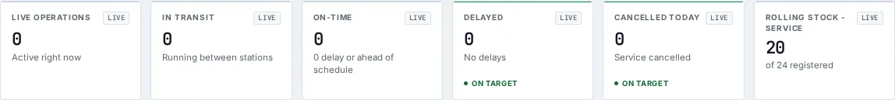
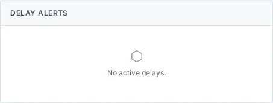
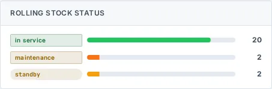

# Train Operations

_Railway › Train Operations_ · Route `/railway/live`

**Train Operations** lets you see real-time SGR &amp; MGR train positions, delays, rolling stock status, and NCTTCA corridor transit performance - refreshes every 30 seconds. Data on this page comes from KRC and NCTTCA.

> 🎬 **Video tutorial:** _coming soon._  
> <!-- VIDEO-URL: railway/train-operations | paste the link here, e.g. [Watch the walkthrough](https://…) -->

## Highlights

- **6 headline tiles** — Live Operations, In Transit, On-Time, Delayed, Cancelled Today, Rolling Stock - Service.
- **3 panels** — Delay Alerts, Rolling Stock Status, All Active Operations.
- An **interactive map** with a legend, full-screen, locate-me and base-map controls.
- **Refreshes itself every 30 seconds**, so you do not need to reload the page.
- **Filters and search** to narrow tables to what you need.
- Every figure is traceable to the data feed or upload template that supplies it — see [Data sources and feeds](#data-sources-and-feeds).

## Enabling and access

1. Sign in to UAPTS (see [How to access](../getting-started/how-to-access.md)).
2. In the left sidebar expand **Railway** and click **Train Operations**.
3. The page opens at `/railway/live`. You can also reach it with the global search (**Ctrl + K**).

This page belongs to module **M08 · Railway**. The sidebar and the global search only list pages your agency and role can open, and a link to a page you cannot reach sends you back to the Command Centre. If a page you expect is missing, ask your agency administrator to check your agency's [Module Access](../access-control/module-access.md).

## Page tour

### Headline tiles

| Tile | What it shows | Data from | Table → ingested via |
|---|---|---|---|
| **Live Operations** | Active right now _(window: LIVE)_ | `/railway/operations/live/` | _TrainOperation_ → no template yet |
| **In Transit** | Running between stations _(window: LIVE)_ | — | — |
| **On-Time** | 0 delay or ahead of schedule _(window: LIVE)_ | `/railway/operations/live/` | _TrainOperation_ → no template yet |
| **Delayed** | — _(window: LIVE)_ | `/railway/operations/live/` | _TrainOperation_ → no template yet |
| **Cancelled Today** | Service cancelled _(window: LIVE)_ | — | — |
| **Rolling Stock - Service** | — _(window: LIVE)_ | `/railway/trains/` | _Train_ → [`krc-train-register`](../data-templates/krc-train-register.xlsx) |

### Delay Alerts

**Data from:** `/railway/operations/live/`  
**Table → ingested via:** _TrainOperation_ → no template yet

### Rolling Stock Status

**Data from:** `/railway/trains/`  
**Table → ingested via:** _Train_ → [`krc-train-register`](../data-templates/krc-train-register.xlsx)

### All Active Operations

Contains a table with the columns **Train**, **Route**, **Date**, **Status**, **Current Station**, **Act. Departure**, **Act. Arrival**, **Dep Delay**, **Arr Delay**, **Passengers**, **Occupancy**.

**Data from:** `/railway/operations/live/`  
**Table → ingested via:** _TrainOperation_ → no template yet

## Working with this page

1. Open **Railway → Train Operations** from the sidebar.
2. Wait for the page to finish loading. It re-fetches its data every **30 s**; the figures you see are the latest the platform holds, not a one-time snapshot.
3. Type in the **“Search train number…”** box to filter what is shown.
4. Use the **All networks** drop-down to narrow the list. Choices include: SGR, MGR.
5. Use the **All statuses** drop-down to narrow the list. Choices include: In Transit, Boarding, Delayed, Departed, Arrived, Cancelled.
6. On the map, drag to pan and scroll (or pinch) to zoom. Click a marker or line for its details. Use the map toolbar to go full-screen, centre on your location, reset the view or switch the base map; click the legend chip to expand it.

## Status and value meanings

These are the values the platform stores for the fields shown on this page (`value` followed by the label you see).

| Field | Table | Values |
|---|---|---|
| status | TrainOperation | `scheduled` · `boarding` · `departed` · `in_transit` · `arrived` · `delayed` · `cancelled` · `diverted` |
| train type | Train | `sgr_emu` SGR EMU (electric) · `sgr_dmu` SGR DMU (diesel) · `mgr_loco` MGR locomotive · `mgr_coach` MGR coach set · `freight_loco` Freight locomotive · `maintenance` Maintenance vehicle |
| status | Train | `in_service` · `standby` On standby · `maintenance` Under maintenance · `retired` · `inspection` Under inspection |

## Data sources and feeds

Every number and table on this page is read from the API endpoints below. The **Ingested via** column says how the underlying records get into UAPTS: a downloadable **upload template** (xlsx/CSV, loaded through the [Integration Hub](../integration-hub/upload-and-connect.md)), a **live feed** that pushes records to the ingest API, or — where neither exists yet — it is stated plainly.

| Endpoint | Records | Ingested via |
|---|---|---|
| `GET /geojson/rail-lines/` | _Aggregate of 1 tables (rows below)_ | — |
| ↳ RailLine | Rail Lines | **No ingestion template yet** — populated by seed data or direct entry |
| `GET /geojson/rail-stations/` | _Aggregate of 1 tables (rows below)_ | — |
| ↳ RailStation | Rail Stations | [`krc-rail-station-register`](../data-templates/krc-rail-station-register.xlsx) |
| `GET /railway/operations/live/` | Train Operations | **No ingestion template yet** — populated by seed data or direct entry |
| `GET /railway/trains/` | Trains | [`krc-train-register`](../data-templates/krc-train-register.xlsx) |

Full details of every template (columns, formats) are in the [Data sources catalogue](../reference/data-sources.md). Interactive API documentation is available at `/api/docs/`.

## Permissions

| Who | What they can do here |
|---|---|
| Public / read-only accounts | View the page where the module is enabled for their agency (read-only). |
| Operator | View the page. |
| Analyst | View and **export CSV**. |
| Agency admin | Everything an analyst can do, plus the administrative capabilities listed in [Roles & Permissions](../access-control/roles-and-permissions.md). |
| Super admin | Sees every agency's data. |

**Agencies with the Railway module:** full — SDT, KRC; selected pages only — KENHA, NAMATA, KPA, NCTTCA, LAPSSET.

_Access is evaluated by the server from the baseline policy plus any agency overrides, so a super admin or agency admin may have changed it from the defaults above._

## Related topics

- [Railway Overview](railway-overview.md)
- [Freight Volumes](freight-volumes.md)
- [Schedules](schedules.md)
- [Rail Infrastructure](rail-infrastructure.md)
- [Rail Network Inventory](rail-network-inventory.md)
- [Rail Safety](rail-safety.md)
- [Railway overview](index.md)
- [Upload & Connect (Integration Hub)](../integration-hub/upload-and-connect.md)
- [Data sources catalogue](../reference/data-sources.md)

## On this page

- [Highlights](#highlights)
- [Enabling and access](#enabling-and-access)
- [Page tour](#page-tour)
- [Working with this page](#working-with-this-page)
- [Status and value meanings](#status-and-value-meanings)
- [Data sources and feeds](#data-sources-and-feeds)
- [Permissions](#permissions)
- [Related topics](#related-topics)

## Support

- **Your agency administrator** is the first contact for access, role and data-quality questions.
- **Data feeds, templates and API questions:** `api-support@uapts.go.ke` (include the `X-Request-ID` response header from a failing call).
- **Security concerns:** `security@uapts.go.ke`. Do not report suspected vulnerabilities publicly.
