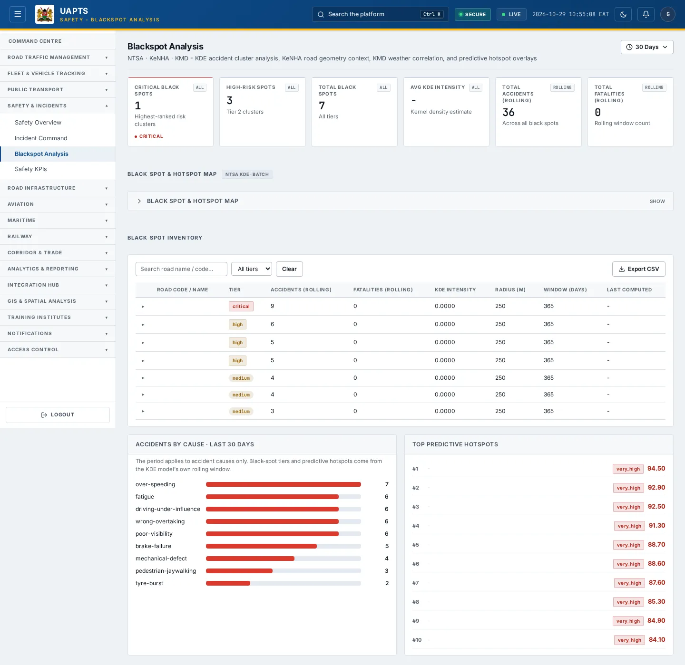
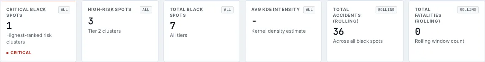
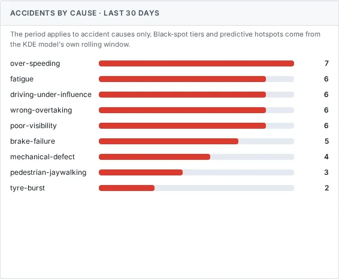
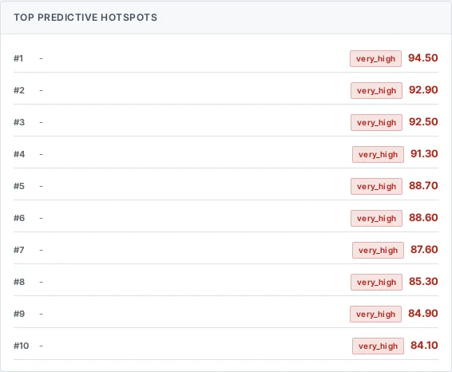

# Blackspot Analysis

_Safety & Incidents › Blackspot Analysis_ · Route `/safety/blackspots`

**Blackspot Analysis** lets you see KDE accident cluster analysis, KeNHA road geometry context, KMD weather correlation, and predictive hotspot overlays. Data on this page comes from NTSA, KeNHA and KMD.

> 🎬 **Video tutorial:** _coming soon._  
> <!-- VIDEO-URL: safety/blackspot-analysis | paste the link here, e.g. [Watch the walkthrough](https://…) -->

## Highlights

- **6 headline tiles** — Critical Black Spots, High-Risk Spots, Total Black Spots, Avg KDE Intensity, Total Accidents (rolling), Total Fatalities (rolling).
- **4 panels** — Black Spot & Hotspot Map, Black Spot Inventory, Accidents by Cause, Top Predictive Hotspots.
- An **interactive map** with a legend, full-screen, locate-me and base-map controls.
- **Refreshes itself every 120 seconds**, so you do not need to reload the page.
- **Export to CSV** for the rows you are looking at (Analyst tier and above).
- **Filters and search** to narrow tables to what you need.
- Every figure is traceable to the data feed or upload template that supplies it — see [Data sources and feeds](#data-sources-and-feeds).

## Enabling and access

1. Sign in to UAPTS (see [How to access](../getting-started/how-to-access.md)).
2. In the left sidebar expand **Safety & Incidents** and click **Blackspot Analysis**.
3. The page opens at `/safety/blackspots`. You can also reach it with the global search (**Ctrl + K**).

This page belongs to module **M05 · Safety and Incidents**. The route needs at least the **Operator** tier to open it. The sidebar and the global search only list pages your agency and role can open, and a link to a page you cannot reach sends you back to the Command Centre. If a page you expect is missing, ask your agency administrator to check your agency's [Module Access](../access-control/module-access.md).

## Filtering by time period

The time-period control sits at the top of the page, under the title. It is a single pill showing the period in use (for example **Last 30 days**); click it to open the choices.

| Choice | What it covers |
|---|---|
| **24 Hours** | The last 24 hours, counted back from now. |
| **7 Days** / **30 Days** | The last 7 or 30 days, counted back from now. **30 Days** is the default. |
| **Year** | One whole calendar year. Use the **‹** and **›** arrows to step to another year. |
| **Custom** | Any first and last day you choose. Both days are included. Use this for a specific period within an agency's historic data. |

How to use a custom range:

1. Click the period pill, then **Custom**.
2. Pick the **from** date, then the **to** date. The page updates as soon as you pick each one. The pickers will not let you choose an end before the start or a day in the future.
3. Click the **^** button (or press **Esc**) to fold the control away. The chosen period stays shown on the pill.

Days are counted in East Africa Time (EAT, UTC+3). The choice is shared by all four Safety pages, so it is still in place when you move from Safety Overview to Incident Command, Blackspot Analysis or Safety KPIs. If you reload the browser page it returns to **30 Days**.

**What the period applies to.** Only **Accidents by Cause** follows the chosen period. Black-spot tiers, the spot list and the predictive hotspots come from the KDE model's own rolling window and do not change with it; the page says so under the Accidents by Cause title.

## Page tour

### Headline tiles

| Tile | What it shows | Data from | Table → ingested via |
|---|---|---|---|
| **Critical Black Spots** | Highest-ranked risk clusters _(window: ALL)_ | — | — |
| **High-Risk Spots** | Tier 2 clusters _(window: ALL)_ | — | — |
| **Total Black Spots** | All tiers _(window: ALL)_ | — | — |
| **Avg KDE Intensity** | Kernel density estimate _(window: ALL)_ | — | — |
| **Total Accidents (rolling)** | Across all black spots _(window: ROLLING)_ | — | — |
| **Total Fatalities (rolling)** | Rolling window count _(window: ROLLING)_ | — | — |

### Black Spot & Hotspot Map

Contains an interactive map.

### Black Spot Inventory

Contains a table with the columns **Road Code / Name**, **Tier**, **Accidents (rolling)**, **Fatalities (rolling)**, **KDE Intensity**, **Radius (m)**, **Window (days)**, **Last Computed**.

### Accidents by Cause

**Data from:** `/safety/predictive-hotspots/`  
**Table → ingested via:** _PredictiveHotspot_ → computed by UAPTS

### Top Predictive Hotspots

**Data from:** `/safety/predictive-hotspots/`  
**Table → ingested via:** _PredictiveHotspot_ → computed by UAPTS

## Working with this page

1. Open **Safety & Incidents → Blackspot Analysis** from the sidebar.
2. Wait for the page to finish loading. It re-fetches its data every **120 s**; the figures you see are the latest the platform holds, not a one-time snapshot.
3. Type in the **“Search road name / code…”** box to filter what is shown.
4. Use the **All tiers** drop-down to narrow the list. Choices include: Critical, High, Medium, Low.
5. Click a row to open its detail.
6. On the map, drag to pan and scroll (or pinch) to zoom. Click a marker or line for its details. Use the map toolbar to go full-screen, centre on your location, reset the view or switch the base map; click the legend chip to expand it.
7. To change the period behind **Accidents by Cause**, use the time-period control (see [Filtering by time period](#filtering-by-time-period)).
8. Click **Export CSV** to download the rows currently loaded (after filters). The button only appears for Analyst tier and above.

## Status and value meanings

These are the values the platform stores for the fields shown on this page (`value` followed by the label you see).

| Field | Table | Values |
|---|---|---|
| ranking tier | BlackSpot | `critical` · `high` · `medium` · `low` |
| risk tier | PredictiveHotspot | `very_high` · `high` · `medium` · `low` |

## Data sources and feeds

Every number and table on this page is read from the API endpoints below. The **Ingested via** column says how the underlying records get into UAPTS: a downloadable **upload template** (xlsx/CSV, loaded through the [Integration Hub](../integration-hub/upload-and-connect.md)), a **live feed** that pushes records to the ingest API, or — where neither exists yet — it is stated plainly.

| Endpoint | Records | Ingested via |
|---|---|---|
| `GET /safety/accidents/by-cause/` | Accidents | [`kenha-crash-records`](../data-templates/kenha-crash-records.xlsx) [`ntsa-crash-records`](../data-templates/ntsa-crash-records.xlsx) [`sdr-crash-records`](../data-templates/sdr-crash-records.xlsx) |
| `GET /safety/black-spots/` | Black Spots | Computed by UAPTS from other data (no direct feed) |
| `GET /safety/black-spots/top/` | Black Spots | Computed by UAPTS from other data (no direct feed) |
| `GET /safety/predictive-hotspots/` | Predictive Hotspots | Computed by UAPTS from other data (no direct feed) |

Full details of every template (columns, formats) are in the [Data sources catalogue](../reference/data-sources.md). Interactive API documentation is available at `/api/docs/`.

## Permissions

| Who | What they can do here |
|---|---|
| Public / read-only accounts | No access to this page. |
| Operator | View the page. |
| Analyst | View and **export CSV**. |
| Agency admin | Everything an analyst can do, plus the administrative capabilities listed in [Roles & Permissions](../access-control/roles-and-permissions.md). |
| Super admin | Sees every agency's data. |

**Agencies with the Safety and Incidents module:** full — KENHA, KURA, KERRA, SDR, NPS, SDT, NTSA; read-only — KCAA, KWS.

_Access is evaluated by the server from the baseline policy plus any agency overrides, so a super admin or agency admin may have changed it from the defaults above._

## Related topics

- [Safety Overview](safety-overview.md)
- [Incident Command](incident-command.md)
- [Safety KPIs](safety-kpis.md)
- [Safety & Incidents overview](index.md)
- [Upload & Connect (Integration Hub)](../integration-hub/upload-and-connect.md)
- [Data sources catalogue](../reference/data-sources.md)

## On this page

- [Highlights](#highlights)
- [Enabling and access](#enabling-and-access)
- [Filtering by time period](#filtering-by-time-period)
- [Page tour](#page-tour)
- [Working with this page](#working-with-this-page)
- [Status and value meanings](#status-and-value-meanings)
- [Data sources and feeds](#data-sources-and-feeds)
- [Permissions](#permissions)
- [Related topics](#related-topics)

## Support

- **Your agency administrator** is the first contact for access, role and data-quality questions.
- **Data feeds, templates and API questions:** `api-support@uapts.go.ke` (include the `X-Request-ID` response header from a failing call).
- **Security concerns:** `security@uapts.go.ke`. Do not report suspected vulnerabilities publicly.
