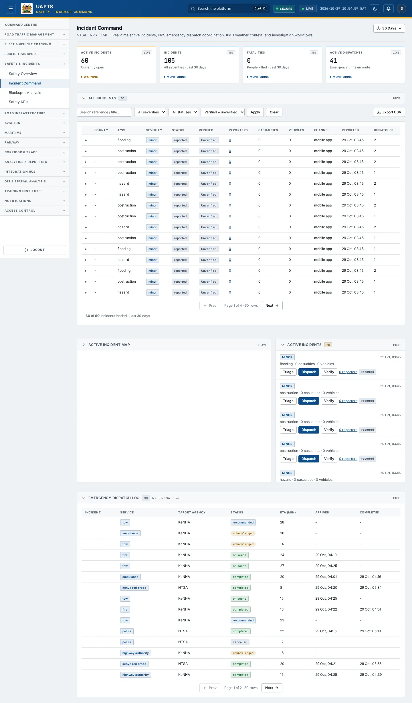
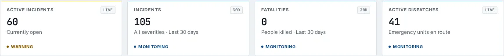

# Incident Command

_Safety & Incidents › Incident Command_ · Route `/safety/incidents`

**Incident Command** lets you see real-time active incidents, NPS emergency dispatch coordination, KMD weather context, and investigation workflows. Data on this page comes from NTSA, NPS and KMD.

> 🎬 **Video tutorial:** _coming soon._  
> <!-- VIDEO-URL: safety/incident-command | paste the link here, e.g. [Watch the walkthrough](https://…) -->

## Highlights

- **A time-period filter** — 24 Hours, 7 Days, 30 Days, a calendar year or any custom from/to range.
- **4 headline tiles** — Active Incidents, Incidents and Fatalities for the chosen period, Active Dispatches.
- An **interactive map** with a legend, full-screen, locate-me and base-map controls.
- **Refreshes itself every 60 seconds**, so you do not need to reload the page.
- **Export to CSV** for the rows you are looking at (Analyst tier and above).
- **Filters and search** to narrow tables to what you need.
- Every figure is traceable to the data feed or upload template that supplies it — see [Data sources and feeds](#data-sources-and-feeds).

## Enabling and access

1. Sign in to UAPTS (see [How to access](../getting-started/how-to-access.md)).
2. In the left sidebar expand **Safety & Incidents** and click **Incident Command**.
3. The page opens at `/safety/incidents`. You can also reach it with the global search (**Ctrl + K**).

This page belongs to module **M05 · Safety and Incidents**. The route needs at least the **Operator** tier to open it. The sidebar and the global search only list pages your agency and role can open, and a link to a page you cannot reach sends you back to the Command Centre. If a page you expect is missing, ask your agency administrator to check your agency's [Module Access](../access-control/module-access.md).

## Filtering by time period

The time-period control sits at the top of the page, under the title. It is a single pill showing the period in use (for example **Last 30 days**); click it to open the choices.

| Choice | What it covers |
|---|---|
| **24 Hours** | The last 24 hours, counted back from now. |
| **7 Days** / **30 Days** | The last 7 or 30 days, counted back from now. **30 Days** is the default. |
| **Year** | One whole calendar year. Use the **‹** and **›** arrows to step to another year. |
| **Custom** | Any first and last day you choose. Both days are included. Use this for a specific period within an agency's historic data. |

How to use a custom range:

1. Click the period pill, then **Custom**.
2. Pick the **from** date, then the **to** date. The page updates as soon as you pick each one. The pickers will not let you choose an end before the start or a day in the future.
3. Click the **^** button (or press **Esc**) to fold the control away. The chosen period stays shown on the pill.

Days are counted in East Africa Time (EAT, UTC+3). The choice is shared by all four Safety pages, so it is still in place when you move from Safety Overview to Incident Command, Blackspot Analysis or Safety KPIs. If you reload the browser page it returns to **30 Days**.

**What the period applies to.** The Incidents and Fatalities tiles, the **All Incidents** table, its CSV export and the map markers follow the chosen period. **Active Incidents**, the active queue and **Active Dispatches** are always live, so an incident that is still open is shown even if it was reported before the period.

**Long periods.** The All Incidents table loads 100 incidents at a time. The footer reads, for example, _“100 of 2,340 incidents loaded · 1 Jan 2010 – 31 Dec 2024”_; click **Load more** to bring in the next 100. The severity, status and verified filters apply together with the period, and **Export to CSV** exports the rows loaded so far, so load more first (or narrow the period) if you need everything.

## Page tour

### Headline tiles

| Tile | What it shows | Data from | Table → ingested via |
|---|---|---|---|
| **Active Incidents** | — _(window: LIVE)_ | `/safety/summary/` | _Incident_ → live feed `ntsa-itims` |
| **Incidents** | Incidents in the chosen period _(badge shows the period)_ | `/safety/incidents/`, `/safety/summary/` | _Incident_ → live feed `ntsa-itims` |
| **Fatalities** | People killed in the chosen period; click it to filter the table to fatal incidents | `/safety/incidents/`, `/safety/summary/` | _Incident_ → live feed `ntsa-itims` |
| **Active Dispatches** | — _(window: LIVE)_ | `/safety/summary/` | _EmergencyDispatch_ → no template yet |

## Working with this page

1. Open **Safety & Incidents → Incident Command** from the sidebar.
2. Wait for the page to finish loading. It re-fetches its data every **60 s**; the figures you see are the latest the platform holds, not a one-time snapshot.
3. Type in the **“Search reference / title…”** box to filter what is shown.
4. Use the **All severities** drop-down to narrow the list. Choices include: Fatal, Serious, Minor.
5. Use the **All statuses** drop-down to narrow the list. Choices include: Reported, Triaged, Dispatched, On Scene, Resolved.
6. Use the **Verified + unverified** drop-down to narrow the list. Choices include: Verified only, Unverified only.
7. Click a row to open its detail.
8. On the map, drag to pan and scroll (or pinch) to zoom. Click a marker or line for its details. Use the map toolbar to go full-screen, centre on your location, reset the view or switch the base map; click the legend chip to expand it.
9. Choose a period with the time-period control, then click **Apply** to re-run the table with your severity, status and verified filters. **Clear** resets those three filters and the search box; it does not change the period.
10. Click **Dispatch** to use this action.
11. Click **Resolve** to use this action.
12. Click **Triage** to use this action.
13. Click **Working&hellip;** to use this action.
14. Click **reporter** to use this action.

## Status and value meanings

These are the values the platform stores for the fields shown on this page (`value` followed by the label you see).

| Field | Table | Values |
|---|---|---|
| service type | EmergencyDispatch | `police` Police (NPS) · `ambulance` · `fire` Fire & Rescue · `kenya_red_cross` · `traffic_police` · `highway_authority` · `tow` Tow Service |
| status | EmergencyDispatch | `recommended` · `acknowledged` · `en_route` · `on_scene` · `completed` · `cancelled` |
| incident type | Incident | `accident` · `hazard` · `obstruction` · `flooding` · `fire` · `security` · `breakdown` Vehicle Breakdown · `rail_incident` Railway Incident · `aviation_incident` · `maritime_incident` |
| severity | Incident | `minor` · `serious` · `fatal` |
| status | Incident | `reported` · `triaged` · `dispatched` · `on_scene` · `resolved` · `closed` · `cancelled` |

## Data sources and feeds

Every number and table on this page is read from the API endpoints below. The **Ingested via** column says how the underlying records get into UAPTS: a downloadable **upload template** (xlsx/CSV, loaded through the [Integration Hub](../integration-hub/upload-and-connect.md)), a **live feed** that pushes records to the ingest API, or — where neither exists yet — it is stated plainly.

| Endpoint | Records | Ingested via |
|---|---|---|
| `GET /safety/emergency-dispatches/` | Emergency Dispatchs | **No ingestion template yet** — populated by seed data or direct entry |
| `GET /safety/incidents/` | Incidents | live feed `ntsa-itims` (NTSA iTIMS) |
| `GET /safety/incidents/{id}/close/` | Incidents | live feed `ntsa-itims` (NTSA iTIMS) |
| `GET /safety/incidents/{id}/dispatch/` | Incidents | live feed `ntsa-itims` (NTSA iTIMS) |
| `GET /safety/incidents/{id}/reporters/` | Incidents | live feed `ntsa-itims` (NTSA iTIMS) |
| `GET /safety/incidents/{id}/resolve/` | Incidents | live feed `ntsa-itims` (NTSA iTIMS) |
| `GET /safety/incidents/{id}/triage/` | Incidents | live feed `ntsa-itims` (NTSA iTIMS) |
| `GET /safety/incidents/{id}/unverify/` | Incidents | live feed `ntsa-itims` (NTSA iTIMS) |
| `GET /safety/incidents/{id}/verify/` | Incidents | live feed `ntsa-itims` (NTSA iTIMS) |
| `GET /safety/summary/` | _Aggregate of 7 tables (rows below)_ | — |
| ↳ Accident | Accidents | [`kenha-crash-records`](../data-templates/kenha-crash-records.xlsx) [`ntsa-crash-records`](../data-templates/ntsa-crash-records.xlsx) [`sdr-crash-records`](../data-templates/sdr-crash-records.xlsx) |
| ↳ BlackSpot | Black Spots | Computed by UAPTS from other data (no direct feed) |
| ↳ EmergencyDispatch | Emergency Dispatchs | **No ingestion template yet** — populated by seed data or direct entry |
| ↳ Incident | Incidents | live feed `ntsa-itims` (NTSA iTIMS) |
| ↳ PredictiveHotspot | Predictive Hotspots | Computed by UAPTS from other data (no direct feed) |
| ↳ SafetyIntervention | Safety Interventions | Computed by UAPTS from other data (no direct feed) |
| ↳ TrafficViolation | Traffic Violations | live feed `ntsa-itims` (NTSA iTIMS) |

Full details of every template (columns, formats) are in the [Data sources catalogue](../reference/data-sources.md). Interactive API documentation is available at `/api/docs/`.

## Permissions

| Who | What they can do here |
|---|---|
| Public / read-only accounts | No access to this page. |
| Operator | View the page. |
| Analyst | View and **export CSV**. |
| Agency admin | Everything an analyst can do, plus the administrative capabilities listed in [Roles & Permissions](../access-control/roles-and-permissions.md). |
| Super admin | Sees every agency's data. |

**Agencies with the Safety and Incidents module:** full — KENHA, KURA, KERRA, SDR, NPS, SDT, NTSA; read-only — KCAA, KWS.

_Access is evaluated by the server from the baseline policy plus any agency overrides, so a super admin or agency admin may have changed it from the defaults above._

## Related topics

- [Safety Overview](safety-overview.md)
- [Blackspot Analysis](blackspot-analysis.md)
- [Safety KPIs](safety-kpis.md)
- [Safety & Incidents overview](index.md)
- [Upload & Connect (Integration Hub)](../integration-hub/upload-and-connect.md)
- [Data sources catalogue](../reference/data-sources.md)

## On this page

- [Highlights](#highlights)
- [Enabling and access](#enabling-and-access)
- [Filtering by time period](#filtering-by-time-period)
- [Page tour](#page-tour)
- [Working with this page](#working-with-this-page)
- [Status and value meanings](#status-and-value-meanings)
- [Data sources and feeds](#data-sources-and-feeds)
- [Permissions](#permissions)
- [Related topics](#related-topics)

## Support

- **Your agency administrator** is the first contact for access, role and data-quality questions.
- **Data feeds, templates and API questions:** `api-support@uapts.go.ke` (include the `X-Request-ID` response header from a failing call).
- **Security concerns:** `security@uapts.go.ke`. Do not report suspected vulnerabilities publicly.
