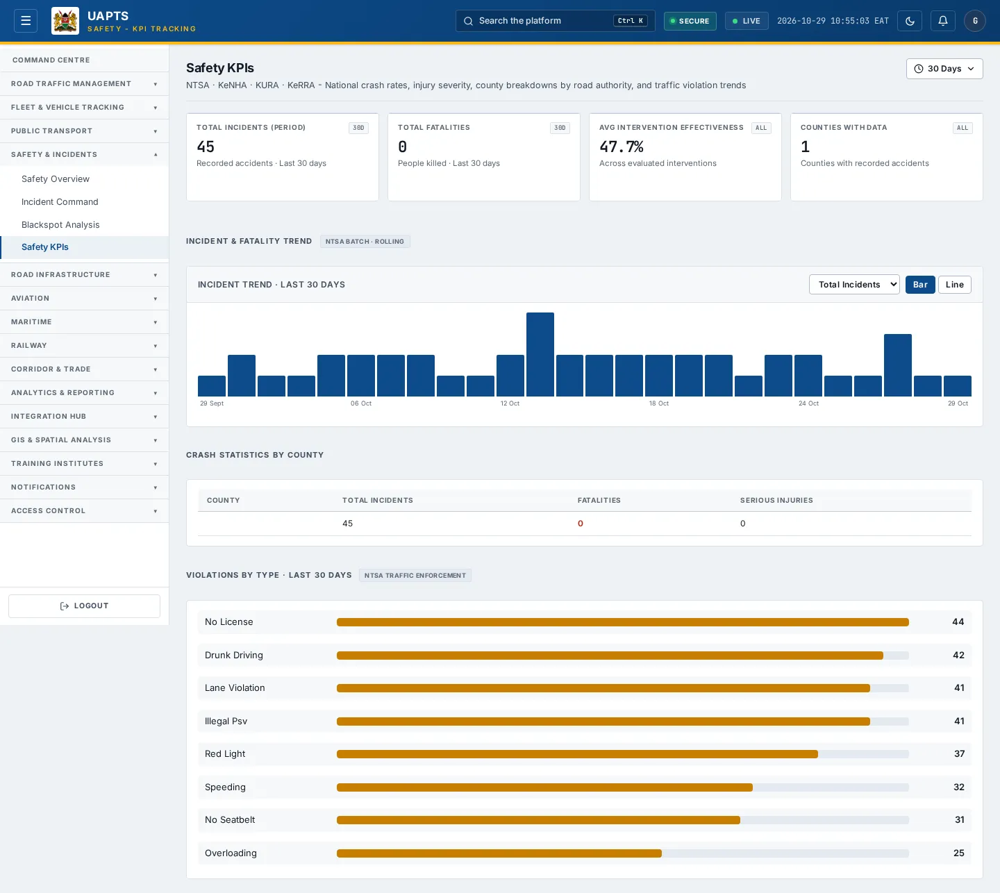
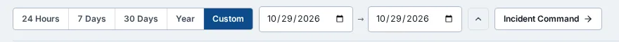
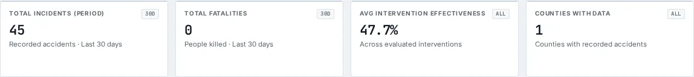

# Safety KPIs

_Safety & Incidents › Safety KPIs_ · Route `/safety/kpis`

**Safety KPIs** lets you see national crash rates, injury severity, county breakdowns by road authority, and traffic violation trends. Data on this page comes from NTSA, KeNHA, KURA and KeRRA.

> 🎬 **Video tutorial:** _coming soon._  
> <!-- VIDEO-URL: safety/safety-kpis | paste the link here, e.g. [Watch the walkthrough](https://…) -->

## Highlights

- **4 headline tiles** — Total Incidents (period), Total Fatalities, Avg Intervention Effectiveness, Counties with Data.
- **2 panels** — Incident Trend Total Incidents Fatalities Injuries Bar Line, Crash Statistics by County.
- **A time-period filter** for the tiles, trend, county table and violations.
- **Refreshes itself every 120 seconds**, so you do not need to reload the page.
- **Filters and search** to narrow tables to what you need.
- Every figure is traceable to the data feed or upload template that supplies it — see [Data sources and feeds](#data-sources-and-feeds).

## Enabling and access

1. Sign in to UAPTS (see [How to access](../getting-started/how-to-access.md)).
2. In the left sidebar expand **Safety & Incidents** and click **Safety KPIs**.
3. The page opens at `/safety/kpis`. You can also reach it with the global search (**Ctrl + K**).

This page belongs to module **M05 · Safety and Incidents**. The sidebar and the global search only list pages your agency and role can open, and a link to a page you cannot reach sends you back to the Command Centre. If a page you expect is missing, ask your agency administrator to check your agency's [Module Access](../access-control/module-access.md).

## Filtering by time period

The time-period control sits at the top of the page, under the title. It is a single pill showing the period in use (for example **Last 30 days**); click it to open the choices.

| Choice | What it covers |
|---|---|
| **24 Hours** | The last 24 hours, counted back from now. |
| **7 Days** / **30 Days** | The last 7 or 30 days, counted back from now. **30 Days** is the default. |
| **Year** | One whole calendar year. Use the **‹** and **›** arrows to step to another year. |
| **Custom** | Any first and last day you choose. Both days are included. Use this for a specific period within an agency's historic data. |

How to use a custom range:

1. Click the period pill, then **Custom**.
2. Pick the **from** date, then the **to** date. The page updates as soon as you pick each one. The pickers will not let you choose an end before the start or a day in the future.
3. Click the **^** button (or press **Esc**) to fold the control away. The chosen period stays shown on the pill.

Days are counted in East Africa Time (EAT, UTC+3). The choice is shared by all four Safety pages, so it is still in place when you move from Safety Overview to Incident Command, Blackspot Analysis or Safety KPIs. If you reload the browser page it returns to **30 Days**.

**What the period applies to.** Total Incidents, Total Fatalities, the Incident Trend, Crash Statistics by County and Violations by Type all follow the chosen period. Average Intervention Effectiveness and Counties with Data are not tied to it. The trend chart draws every bar for the period; for long ranges the bars are months rather than days.

## Page tour

### Headline tiles

| Tile | What it shows | Data from | Table → ingested via |
|---|---|---|---|
| **Total Incidents (period)** | Recorded accidents in window | — | — |
| **Total Fatalities** | People killed in window | — | — |
| **Avg Intervention Effectiveness** | Across evaluated interventions _(window: ALL)_ | — | — |
| **Counties with Data** | Counties with recorded accidents _(window: ALL)_ | — | — |

### Incident Trend Total Incidents Fatalities Injuries Bar Line

Contains a chart.

### Crash Statistics by County

Contains a table with the columns **County**, **Total Incidents**, **Fatalities**, **Serious Injuries**.

## Working with this page

1. Open **Safety & Incidents → Safety KPIs** from the sidebar.
2. Wait for the page to finish loading. It re-fetches its data every **120 s**; the figures you see are the latest the platform holds, not a one-time snapshot.
3. Use the **Total Incidents** drop-down to narrow the list. Choices include: Fatalities, Injuries.
4. Click **Bar** to use this action.
5. Click **Line** to use this action.
6. To look at a different period, use the time-period control (see [Filtering by time period](#filtering-by-time-period)). The tiles, trend chart, county table and violations all change together.

## Status and value meanings

These are the values the platform stores for the fields shown on this page (`value` followed by the label you see).

| Field | Table | Values |
|---|---|---|
| violation type | TrafficViolation | `speeding` · `red_light` · `lane_violation` · `no_seatbelt` · `drunk_driving` · `no_license` No Driving Licence · `illegal_psv` Illegal PSV Operation · `overloading` · `other` |

## Data sources and feeds

Every number and table on this page is read from the API endpoints below. The **Ingested via** column says how the underlying records get into UAPTS: a downloadable **upload template** (xlsx/CSV, loaded through the [Integration Hub](../integration-hub/upload-and-connect.md)), a **live feed** that pushes records to the ingest API, or — where neither exists yet — it is stated plainly.

| Endpoint | Records | Ingested via |
|---|---|---|
| `GET /safety/kpis/by-county/` | Safety Kpis | Computed by UAPTS from other data (no direct feed) |
| `GET /safety/kpis/trend/` | Safety Kpis | Computed by UAPTS from other data (no direct feed) |
| `GET /safety/summary/` | _Aggregate of 7 tables (rows below)_ | — |
| ↳ Accident | Accidents | [`kenha-crash-records`](../data-templates/kenha-crash-records.xlsx) [`ntsa-crash-records`](../data-templates/ntsa-crash-records.xlsx) [`sdr-crash-records`](../data-templates/sdr-crash-records.xlsx) |
| ↳ BlackSpot | Black Spots | Computed by UAPTS from other data (no direct feed) |
| ↳ EmergencyDispatch | Emergency Dispatchs | **No ingestion template yet** — populated by seed data or direct entry |
| ↳ Incident | Incidents | live feed `ntsa-itims` (NTSA iTIMS) |
| ↳ PredictiveHotspot | Predictive Hotspots | Computed by UAPTS from other data (no direct feed) |
| ↳ SafetyIntervention | Safety Interventions | Computed by UAPTS from other data (no direct feed) |
| ↳ TrafficViolation | Traffic Violations | live feed `ntsa-itims` (NTSA iTIMS) |
| `GET /safety/traffic-violations/by-type/` | Traffic Violations | live feed `ntsa-itims` (NTSA iTIMS) |

Full details of every template (columns, formats) are in the [Data sources catalogue](../reference/data-sources.md). Interactive API documentation is available at `/api/docs/`.

## Permissions

| Who | What they can do here |
|---|---|
| Public / read-only accounts | View the page where the module is enabled for their agency (read-only). |
| Operator | View the page. |
| Analyst | View and **export CSV**. |
| Agency admin | Everything an analyst can do, plus the administrative capabilities listed in [Roles & Permissions](../access-control/roles-and-permissions.md). |
| Super admin | Sees every agency's data. |

**Agencies with the Safety and Incidents module:** full — KENHA, KURA, KERRA, SDR, NPS, SDT, NTSA; read-only — KCAA, KWS.

_Access is evaluated by the server from the baseline policy plus any agency overrides, so a super admin or agency admin may have changed it from the defaults above._

## Related topics

- [Safety Overview](safety-overview.md)
- [Incident Command](incident-command.md)
- [Blackspot Analysis](blackspot-analysis.md)
- [Safety & Incidents overview](index.md)
- [Upload & Connect (Integration Hub)](../integration-hub/upload-and-connect.md)
- [Data sources catalogue](../reference/data-sources.md)

## On this page

- [Highlights](#highlights)
- [Enabling and access](#enabling-and-access)
- [Filtering by time period](#filtering-by-time-period)
- [Page tour](#page-tour)
- [Working with this page](#working-with-this-page)
- [Status and value meanings](#status-and-value-meanings)
- [Data sources and feeds](#data-sources-and-feeds)
- [Permissions](#permissions)
- [Related topics](#related-topics)

## Support

- **Your agency administrator** is the first contact for access, role and data-quality questions.
- **Data feeds, templates and API questions:** `api-support@uapts.go.ke` (include the `X-Request-ID` response header from a failing call).
- **Security concerns:** `security@uapts.go.ke`. Do not report suspected vulnerabilities publicly.
