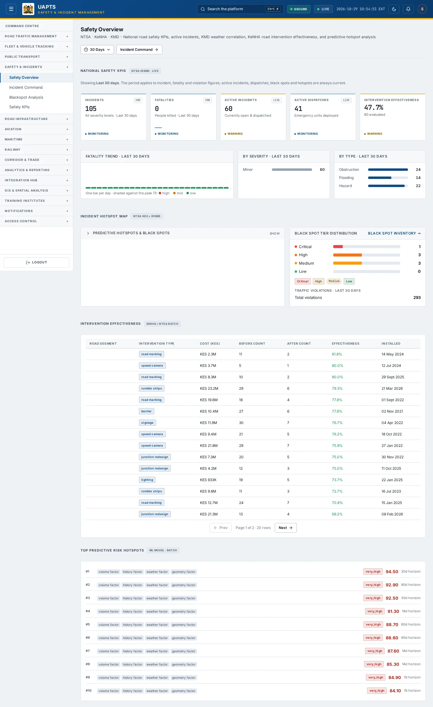
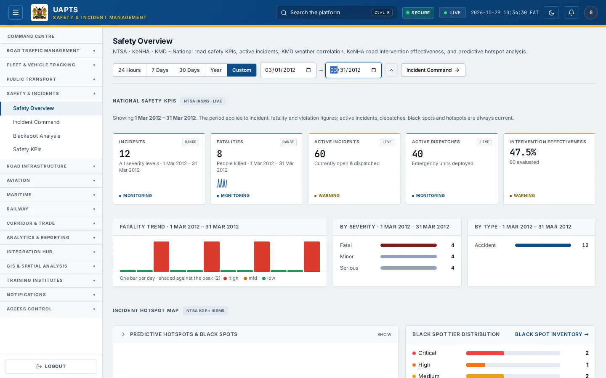
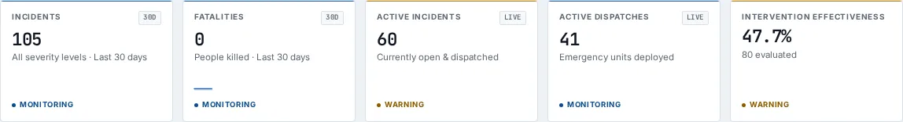
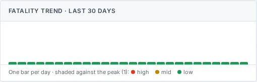
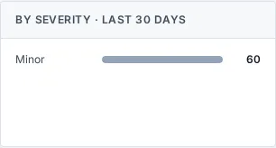
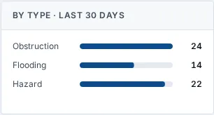
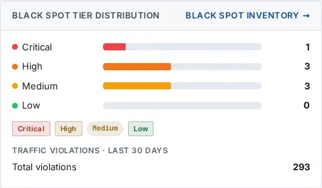

# Safety Overview

_Safety & Incidents › Safety Overview_ · Route `/safety`

**Safety Overview** lets you see national road safety KPIs, active incidents, KMD weather correlation, KeNHA road intervention effectiveness, and predictive hotspot analysis. Data on this page comes from NTSA, KeNHA and KMD.

> 🎬 **Video tutorial:** _coming soon._  
> <!-- VIDEO-URL: safety/safety-overview | paste the link here, e.g. [Watch the walkthrough](https://…) -->

## Highlights

- **A time-period filter** — 24 Hours, 7 Days, 30 Days, a calendar year or any custom from/to range, so you can look at a specific period of an agency's historic incidents.
- **6 headline tiles** — Incidents and Fatalities for the chosen period, then Active Incidents, Active Dispatches, Intervention Effectiveness.
- **6 panels** — Fatality Trend, By Severity, By Type, Incident Hotspot Map, Black Spot Tier Distribution Black Spot Inventory, Intervention Effectiveness.
- An **interactive map** with a legend, full-screen, locate-me and base-map controls.
- **Refreshes itself every 120 seconds**, so you do not need to reload the page.
- Every figure is traceable to the data feed or upload template that supplies it — see [Data sources and feeds](#data-sources-and-feeds).

## Enabling and access

1. Sign in to UAPTS (see [How to access](../getting-started/how-to-access.md)).
2. In the left sidebar expand **Safety & Incidents** and click **Safety Overview**.
3. The page opens at `/safety`. You can also reach it with the global search (**Ctrl + K**).

This page belongs to module **M05 · Safety and Incidents**. The sidebar and the global search only list pages your agency and role can open, and a link to a page you cannot reach sends you back to the Command Centre. If a page you expect is missing, ask your agency administrator to check your agency's [Module Access](../access-control/module-access.md).

## Filtering by time period

The time-period control sits at the top of the page, under the title. It is a single pill showing the period in use (for example **Last 30 days**); click it to open the choices.

| Choice | What it covers |
|---|---|
| **24 Hours** | The last 24 hours, counted back from now. |
| **7 Days** / **30 Days** | The last 7 or 30 days, counted back from now. **30 Days** is the default. |
| **Year** | One whole calendar year. Use the **‹** and **›** arrows to step to another year. |
| **Custom** | Any first and last day you choose. Both days are included. Use this for a specific period within an agency's historic data. |

How to use a custom range:

1. Click the period pill, then **Custom**.
2. Pick the **from** date, then the **to** date. The page updates as soon as you pick each one. The pickers will not let you choose an end before the start or a day in the future.
3. Click the **^** button (or press **Esc**) to fold the control away. The chosen period stays shown on the pill.

Days are counted in East Africa Time (EAT, UTC+3). The choice is shared by all four Safety pages, so it is still in place when you move from Safety Overview to Incident Command, Blackspot Analysis or Safety KPIs. If you reload the browser page it returns to **30 Days**.

**What the period applies to.** Incidents, Fatalities, the Fatality Trend, By Severity, By Type and Traffic Violations follow the chosen period. Active Incidents, Active Dispatches, Black Spot Tier Distribution, the hotspot map and Intervention Effectiveness are always current and do not change with it.

## Page tour

### Headline tiles

| Tile | What it shows | Data from | Table → ingested via |
|---|---|---|---|
| **Incidents** | Incidents in the chosen period, all severities _(badge shows the period, e.g. 30D or RANGE)_ | `/safety/summary/` | _Incident_ → live feed `ntsa-itims` |
| **Fatalities** | People killed in the chosen period _(badge shows the period)_ | `/safety/summary/` | aggregate of several tables — see [per-table feeds](#data-sources-and-feeds) |
| **Active Incidents** | — _(window: LIVE)_ | `/safety/summary/` | _Incident_ → live feed `ntsa-itims` |
| **Active Dispatches** | — _(window: LIVE)_ | `/safety/summary/` | _EmergencyDispatch_ → no template yet |
| **Intervention Effectiveness** | — | `/safety/interventions/`, `/safety/summary/` | _SafetyIntervention_ → computed by UAPTS |

### Fatality Trend

One bar per hour, day or month depending on the length of the period (hours up to 3 days, days up to about 4 months, months beyond that). Bar colours are relative to the highest bar in the period, so a long range stays readable.

**Data from:** `/safety/summary/`  
**Table → ingested via:** aggregate of several tables — see [per-table feeds](#data-sources-and-feeds)

### By Severity

**Data from:** `/safety/summary/`  
**Table → ingested via:** aggregate of several tables — see [per-table feeds](#data-sources-and-feeds)

### By Type

**Data from:** `/safety/summary/`  
**Table → ingested via:** aggregate of several tables — see [per-table feeds](#data-sources-and-feeds)

### Incident Hotspot Map

Contains an interactive map.

**Data from:** `/safety/interventions/`  
**Table → ingested via:** _SafetyIntervention_ → computed by UAPTS

### Black Spot Tier Distribution Black Spot Inventory

**Data from:** `/safety/black-spots/top/`, `/safety/summary/`  
**Table → ingested via:** _BlackSpot_ → computed by UAPTS

### Intervention Effectiveness

Contains a table with the columns **Road Segment**, **Intervention Type**, **Cost (KES)**, **Before Count**, **After Count**, **Effectiveness**, **Installed**.

**Data from:** `/safety/interventions/`, `/safety/predictive-hotspots/`  
**Table → ingested via:** _SafetyIntervention, PredictiveHotspot_ → computed by UAPTS

## Working with this page

1. Open **Safety & Incidents → Safety Overview** from the sidebar.
2. Wait for the page to finish loading. It re-fetches its data every **120 s**; the figures you see are the latest the platform holds, not a one-time snapshot.
3. On the map, drag to pan and scroll (or pinch) to zoom. Click a marker or line for its details. Use the map toolbar to go full-screen, centre on your location, reset the view or switch the base map; click the legend chip to expand it.
4. To look at a different period, use the time-period control (see [Filtering by time period](#filtering-by-time-period)).

## Status and value meanings

These are the values the platform stores for the fields shown on this page (`value` followed by the label you see).

| Field | Table | Values |
|---|---|---|
| ranking tier | BlackSpot | `critical` · `high` · `medium` · `low` |
| intervention type | SafetyIntervention | `speed_cushion` · `rumble_strips` · `footbridge` · `signage` Signage Upgrade · `lighting` Street Lighting · `road_marking` · `junction_redesign` · `barrier` Median Barrier · `speed_camera` |
| risk tier | PredictiveHotspot | `very_high` · `high` · `medium` · `low` |

## Data sources and feeds

Every number and table on this page is read from the API endpoints below. The **Ingested via** column says how the underlying records get into UAPTS: a downloadable **upload template** (xlsx/CSV, loaded through the [Integration Hub](../integration-hub/upload-and-connect.md)), a **live feed** that pushes records to the ingest API, or — where neither exists yet — it is stated plainly.

| Endpoint | Records | Ingested via |
|---|---|---|
| `GET /safety/black-spots/top/` | Black Spots | Computed by UAPTS from other data (no direct feed) |
| `GET /safety/interventions/` | Safety Interventions | Computed by UAPTS from other data (no direct feed) |
| `GET /safety/predictive-hotspots/` | Predictive Hotspots | Computed by UAPTS from other data (no direct feed) |
| `GET /safety/summary/` | _Aggregate of 7 tables (rows below)_ | — |
| ↳ Accident | Accidents | [`kenha-crash-records`](../data-templates/kenha-crash-records.xlsx) [`ntsa-crash-records`](../data-templates/ntsa-crash-records.xlsx) [`sdr-crash-records`](../data-templates/sdr-crash-records.xlsx) |
| ↳ BlackSpot | Black Spots | Computed by UAPTS from other data (no direct feed) |
| ↳ EmergencyDispatch | Emergency Dispatchs | **No ingestion template yet** — populated by seed data or direct entry |
| ↳ Incident | Incidents | live feed `ntsa-itims` (NTSA iTIMS) |
| ↳ PredictiveHotspot | Predictive Hotspots | Computed by UAPTS from other data (no direct feed) |
| ↳ SafetyIntervention | Safety Interventions | Computed by UAPTS from other data (no direct feed) |
| ↳ TrafficViolation | Traffic Violations | live feed `ntsa-itims` (NTSA iTIMS) |

Full details of every template (columns, formats) are in the [Data sources catalogue](../reference/data-sources.md). Interactive API documentation is available at `/api/docs/`.

## Permissions

| Who | What they can do here |
|---|---|
| Public / read-only accounts | View the page where the module is enabled for their agency (read-only). |
| Operator | View the page. |
| Analyst | View and **export CSV**. |
| Agency admin | Everything an analyst can do, plus the administrative capabilities listed in [Roles & Permissions](../access-control/roles-and-permissions.md). |
| Super admin | Sees every agency's data. |

**Agencies with the Safety and Incidents module:** full — KENHA, KURA, KERRA, SDR, NPS, SDT, NTSA; read-only — KCAA, KWS.

_Access is evaluated by the server from the baseline policy plus any agency overrides, so a super admin or agency admin may have changed it from the defaults above._

## Related topics

- [Incident Command](incident-command.md)
- [Blackspot Analysis](blackspot-analysis.md)
- [Safety KPIs](safety-kpis.md)
- [Safety & Incidents overview](index.md)
- [Upload & Connect (Integration Hub)](../integration-hub/upload-and-connect.md)
- [Data sources catalogue](../reference/data-sources.md)

## On this page

- [Highlights](#highlights)
- [Enabling and access](#enabling-and-access)
- [Filtering by time period](#filtering-by-time-period)
- [Page tour](#page-tour)
- [Working with this page](#working-with-this-page)
- [Status and value meanings](#status-and-value-meanings)
- [Data sources and feeds](#data-sources-and-feeds)
- [Permissions](#permissions)
- [Related topics](#related-topics)

## Support

- **Your agency administrator** is the first contact for access, role and data-quality questions.
- **Data feeds, templates and API questions:** `api-support@uapts.go.ke` (include the `X-Request-ID` response header from a failing call).
- **Security concerns:** `security@uapts.go.ke`. Do not report suspected vulnerabilities publicly.
