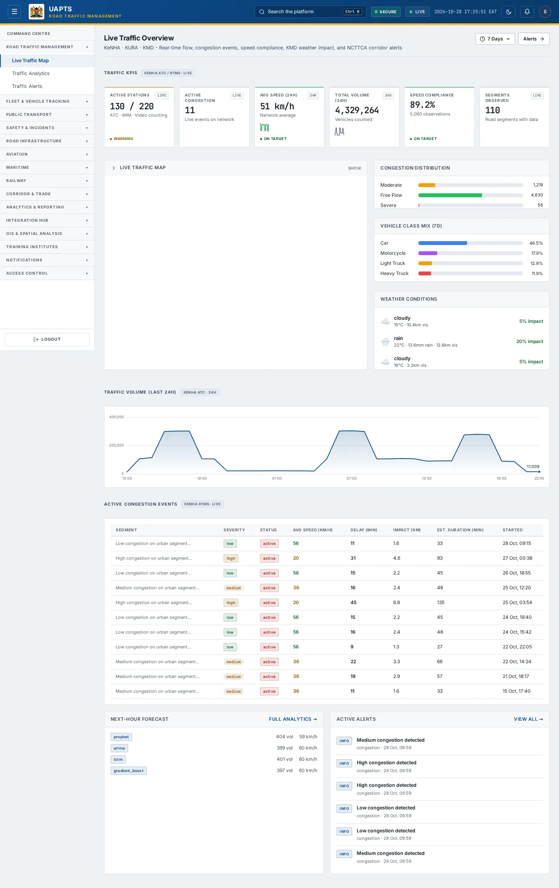
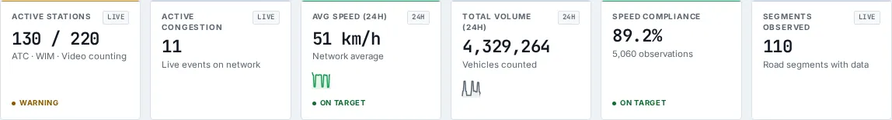
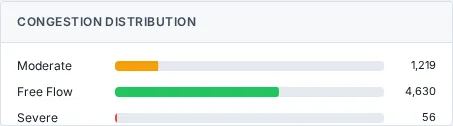
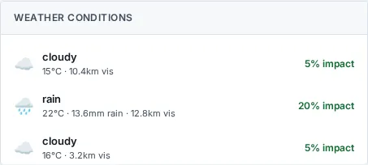
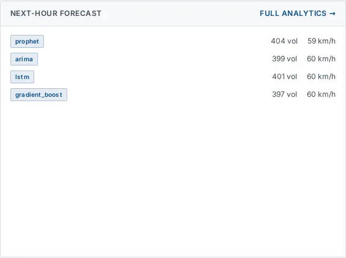
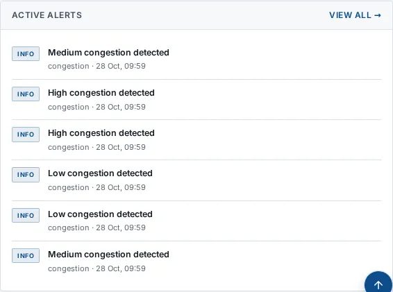

# Live Traffic Map

_Road Traffic Management › Live Traffic Map_ · Route `/traffic`

**Live Traffic Overview** lets you see real-time flow, congestion events, speed compliance, KMD weather impact, and NCTTCA corridor alerts. Data on this page comes from KeNHA, KURA and KMD.

> 🎬 **Video tutorial:** _coming soon._  
> <!-- VIDEO-URL: traffic/live-traffic-map | paste the link here, e.g. [Watch the walkthrough](https://…) -->

## Highlights

- **6 headline tiles** — Active Stations, Active Congestion, Avg Speed (24h), Total Volume (24h), Speed Compliance, Segments Observed.
- **7 panels** — Congestion Distribution, Vehicle Class Mix (), Weather Conditions, Traffic Volume (Last 24h), Active Congestion Events, Next-Hour Forecast….
- An **interactive map** with a legend, full-screen, locate-me and base-map controls.
- **Refreshes itself every 60 seconds**, so you do not need to reload the page.
- Every figure is traceable to the data feed or upload template that supplies it — see [Data sources and feeds](#data-sources-and-feeds).

## Enabling and access

1. Sign in to UAPTS (see [How to access](../getting-started/how-to-access.md)).
2. In the left sidebar expand **Road Traffic Management** and click **Live Traffic Map**.
3. The page opens at `/traffic`. You can also reach it with the global search (**Ctrl + K**).

This page belongs to module **M02 · Road Traffic**. The sidebar and the global search only list pages your agency and role can open, and a link to a page you cannot reach sends you back to the Command Centre. If a page you expect is missing, ask your agency administrator to check your agency's [Module Access](../access-control/module-access.md).

## Page tour

### Headline tiles

| Tile | What it shows | Data from | Table → ingested via |
|---|---|---|---|
| **Active Stations** | ATC · WIM · Video counting _(window: LIVE)_ | `/traffic/summary/` | _CountingStation_ → [`kura-counting-station-register`](../data-templates/kura-counting-station-register.xlsx) [`kenha-counting-station-register`](../data-templates/kenha-counting-station-register.xlsx) [`ntsa-counting-station-register`](../data-templates/ntsa-counting-station-register.xlsx) |
| **Active Congestion** | Live events on network _(window: LIVE)_ | `/traffic/summary/` | _CongestionEvent_ → live telemetry push (no template yet) |
| **Avg Speed (24h)** | Network average _(window: 24H)_ | `/traffic/summary/` | _SpeedObservation_ → live telemetry push (no template yet) |
| **Total Volume (24h)** | Vehicles counted _(window: 24H)_ | `/traffic/summary/` | _Vehicle_ → [`ntsa-psv-fleet-register`](../data-templates/ntsa-psv-fleet-register.xlsx) |
| **Speed Compliance** | — | `/traffic/summary/` | _SpeedObservation_ → live telemetry push (no template yet) |
| **Segments Observed** | Road segments with data _(window: LIVE)_ | `/traffic/summary/` | aggregate of several tables — see [per-table feeds](#data-sources-and-feeds) |

### Congestion Distribution

**Data from:** `/traffic/summary/`  
**Table → ingested via:** _CongestionEvent_ → live telemetry push (no template yet)

### Vehicle Class Mix ()

**Data from:** `/traffic/classifications/share/`, `/traffic/summary/`  
**Table → ingested via:** _VehicleClassification, Vehicle_ → [`ntsa-psv-fleet-register`](../data-templates/ntsa-psv-fleet-register.xlsx)

### Weather Conditions

**Data from:** `/traffic/weather/`  
**Table → ingested via:** _WeatherObservation_ → live telemetry push (no template yet)

### Traffic Volume (Last 24h)

Contains a chart.

**Data from:** `/traffic/summary/`  
**Table → ingested via:** _TrafficCount, TrafficForecast_ → live telemetry push (no template yet)

### Active Congestion Events

Contains a table with the columns **Segment**, **Severity**, **Status**, **Avg Speed (km/h)**, **Delay (min)**, **Impact (km)**, **Est. Duration (min)**, **Started**.

**Data from:** `/traffic/alerts/`, `/traffic/congestion-events/active/`  
**Table → ingested via:** _TrafficAlert, CongestionEvent_ → computed by UAPTS

### Next-Hour Forecast

**Data from:** `/traffic/alerts/`, `/traffic/summary/`  
**Table → ingested via:** _TrafficAlert, TrafficForecast_ → computed by UAPTS

### Active Alerts

**Data from:** `/traffic/alerts/`  
**Table → ingested via:** _TrafficAlert_ → computed by UAPTS

## Working with this page

1. Open **Road Traffic Management → Live Traffic Map** from the sidebar.
2. Wait for the page to finish loading. It re-fetches its data every **60 s**; the figures you see are the latest the platform holds, not a one-time snapshot.
3. On the map, drag to pan and scroll (or pinch) to zoom. Click a marker or line for its details. Use the map toolbar to go full-screen, centre on your location, reset the view or switch the base map; click the legend chip to expand it.
4. Click **↻ Refresh** to refresh the data.

## Status and value meanings

These are the values the platform stores for the fields shown on this page (`value` followed by the label you see).

| Field | Table | Values |
|---|---|---|
| alert type | TrafficAlert | `congestion` · `incident` · `weather` · `road_closure` |
| severity | TrafficAlert | `info` · `warning` · `critical` |
| vehicle class | VehicleClassification | `motorcycle` · `car` · `light_truck` · `heavy_truck` · `bus` · `other` |
| severity | CongestionEvent | `low` · `medium` · `high` · `critical` |
| status | CongestionEvent | `active` · `cleared` · `scheduled` |
| condition | WeatherObservation | `clear` · `cloudy` · `rain` · `heavy_rain` · `fog` · `storm` |

## Data sources and feeds

Every number and table on this page is read from the API endpoints below. The **Ingested via** column says how the underlying records get into UAPTS: a downloadable **upload template** (xlsx/CSV, loaded through the [Integration Hub](../integration-hub/upload-and-connect.md)), a **live feed** that pushes records to the ingest API, or — where neither exists yet — it is stated plainly.

| Endpoint | Records | Ingested via |
|---|---|---|
| `GET /traffic/alerts/` | Traffic Alerts | Computed by UAPTS from other data (no direct feed) |
| `GET /traffic/classifications/share/` | Vehicle Classifications | Live telemetry — push via `POST /api/v1/integrations/<source_id>/ingest/`; **no template or handler yet** |
| `GET /traffic/congestion-events/` | Congestion Events | Live telemetry — push via `POST /api/v1/integrations/<source_id>/ingest/`; **no template or handler yet** |
| `GET /traffic/congestion-events/active/` | Congestion Events | Live telemetry — push via `POST /api/v1/integrations/<source_id>/ingest/`; **no template or handler yet** |
| `GET /traffic/counting-stations/` | Counting Stations | [`kura-counting-station-register`](../data-templates/kura-counting-station-register.xlsx) [`kenha-counting-station-register`](../data-templates/kenha-counting-station-register.xlsx) [`ntsa-counting-station-register`](../data-templates/ntsa-counting-station-register.xlsx) |
| `GET /traffic/counts/` | Traffic Counts | Live telemetry — push via `POST /api/v1/integrations/<source_id>/ingest/`; **no template or handler yet** |
| `GET /traffic/summary/` | _Aggregate of 7 tables (rows below)_ | — |
| ↳ Vehicle | Vehicles | [`ntsa-psv-fleet-register`](../data-templates/ntsa-psv-fleet-register.xlsx) |
| ↳ CongestionEvent | Congestion Events | Live telemetry — push via `POST /api/v1/integrations/<source_id>/ingest/`; **no template or handler yet** |
| ↳ CountingStation | Counting Stations | [`kura-counting-station-register`](../data-templates/kura-counting-station-register.xlsx) [`kenha-counting-station-register`](../data-templates/kenha-counting-station-register.xlsx) [`ntsa-counting-station-register`](../data-templates/ntsa-counting-station-register.xlsx) |
| ↳ SpeedObservation | Speed Observations | Live telemetry — push via `POST /api/v1/integrations/<source_id>/ingest/`; **no template or handler yet** |
| ↳ TrafficCount | Traffic Counts | Live telemetry — push via `POST /api/v1/integrations/<source_id>/ingest/`; **no template or handler yet** |
| ↳ TrafficForecast | Traffic Forecasts | Computed by UAPTS from other data (no direct feed) |
| ↳ VehicleClassification | Vehicle Classifications | Live telemetry — push via `POST /api/v1/integrations/<source_id>/ingest/`; **no template or handler yet** |
| `GET /traffic/weather/` | Weather Observations | Live telemetry — push via `POST /api/v1/integrations/<source_id>/ingest/`; **no template or handler yet** |

Full details of every template (columns, formats) are in the [Data sources catalogue](../reference/data-sources.md). Interactive API documentation is available at `/api/docs/`.

## Permissions

| Who | What they can do here |
|---|---|
| Public / read-only accounts | View the page where the module is enabled for their agency (read-only). |
| Operator | View the page. |
| Analyst | View and **export CSV**. |
| Agency admin | Everything an analyst can do, plus the administrative capabilities listed in [Roles & Permissions](../access-control/roles-and-permissions.md). |
| Super admin | Sees every agency's data. |

**Agencies with the Road Traffic module:** full — KENHA, KURA, KERRA, SDR, SDT, NAMATA; read-only — COUNTY_GOV, KRB, NPS; selected pages only — KMD, NTSA, NCTTCA.

_Access is evaluated by the server from the baseline policy plus any agency overrides, so a super admin or agency admin may have changed it from the defaults above._

## Related topics

- [Traffic Analytics](traffic-analytics.md)
- [Traffic Alerts](traffic-alerts.md)
- [Road Traffic Management overview](index.md)
- [Upload & Connect (Integration Hub)](../integration-hub/upload-and-connect.md)
- [Data sources catalogue](../reference/data-sources.md)

## On this page

- [Highlights](#highlights)
- [Enabling and access](#enabling-and-access)
- [Page tour](#page-tour)
- [Working with this page](#working-with-this-page)
- [Status and value meanings](#status-and-value-meanings)
- [Data sources and feeds](#data-sources-and-feeds)
- [Permissions](#permissions)
- [Related topics](#related-topics)

## Support

- **Your agency administrator** is the first contact for access, role and data-quality questions.
- **Data feeds, templates and API questions:** `api-support@uapts.go.ke` (include the `X-Request-ID` response header from a failing call).
- **Security concerns:** `security@uapts.go.ke`. Do not report suspected vulnerabilities publicly.
