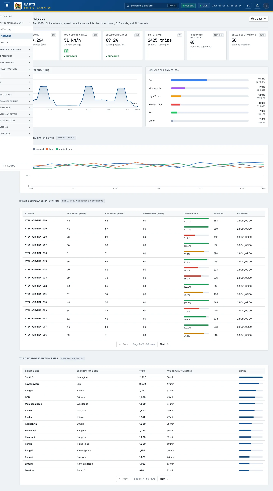
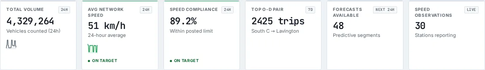
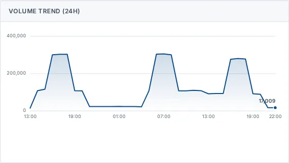

# Traffic Analytics

_Road Traffic Management › Traffic Analytics_ · Route `/traffic/analytics`

**Traffic Analytics** lets you see volume trends, speed compliance, vehicle class breakdown, O-D matrix, and AI forecasts. Data on this page comes from KeNHA, KURA and KMD.

> 🎬 **Video tutorial:** _coming soon._  
> <!-- VIDEO-URL: traffic/traffic-analytics | paste the link here, e.g. [Watch the walkthrough](https://…) -->

## Highlights

- **6 headline tiles** — Total Volume, Avg Network Speed, Speed Compliance, Top O-D Pair, Forecasts Available, Speed Observations.
- **5 panels** — Volume Trend (24h), Vehicle Class Mix (), 24-Hour Traffic Forecast, Speed Compliance by Station, Top Origin-Destination Pairs.
- **Refreshes itself every 120 seconds**, so you do not need to reload the page.
- Every figure is traceable to the data feed or upload template that supplies it — see [Data sources and feeds](#data-sources-and-feeds).

## Enabling and access

1. Sign in to UAPTS (see [How to access](../getting-started/how-to-access.md)).
2. In the left sidebar expand **Road Traffic Management** and click **Traffic Analytics**.
3. The page opens at `/traffic/analytics`. You can also reach it with the global search (**Ctrl + K**).

This page belongs to module **M02 · Road Traffic**. The sidebar and the global search only list pages your agency and role can open, and a link to a page you cannot reach sends you back to the Command Centre. If a page you expect is missing, ask your agency administrator to check your agency's [Module Access](../access-control/module-access.md).

## Page tour

### Headline tiles

| Tile | What it shows | Data from | Table → ingested via |
|---|---|---|---|
| **Total Volume** | Vehicles counted (24h) _(window: 24H)_ | `/traffic/summary/` | _Vehicle_ → [`ntsa-psv-fleet-register`](../data-templates/ntsa-psv-fleet-register.xlsx) |
| **Avg Network Speed** | 24-hour average _(window: 24H)_ | `/traffic/summary/` | _SpeedObservation_ → live telemetry push (no template yet) |
| **Speed Compliance** | Within posted limit _(window: 24H)_ | `/traffic/summary/` | _SpeedObservation_ → live telemetry push (no template yet) |
| **Top O-D Pair** | — | `/traffic/od-matrices/top-pairs/` | _ODMatrix_ → computed by UAPTS |
| **Forecasts Available** | Predictive segments _(window: NEXT 24H)_ | `/traffic/forecasts/` | _TrafficForecast_ → computed by UAPTS |
| **Speed Observations** | Stations reporting _(window: LIVE)_ | `/traffic/speed-observations/` | _SpeedObservation_ → live telemetry push (no template yet) |

### Volume Trend (24h)

Contains a chart.

**Data from:** `/traffic/summary/`  
**Table → ingested via:** aggregate of several tables — see [per-table feeds](#data-sources-and-feeds)

### Vehicle Class Mix ()

**Data from:** `/traffic/classifications/share/`, `/traffic/summary/`  
**Table → ingested via:** _VehicleClassification, Vehicle_ → [`ntsa-psv-fleet-register`](../data-templates/ntsa-psv-fleet-register.xlsx)

### 24-Hour Traffic Forecast

Contains a chart.

**Data from:** `/traffic/forecasts/`  
**Table → ingested via:** _TrafficForecast_ → computed by UAPTS

### Speed Compliance by Station

Contains a table with the columns **Station**, **Avg Speed (km/h)**, **P85 Speed (km/h)**, **Speed Limit (km/h)**, **Compliance**, **Samples**, **Recorded**.

**Data from:** `/traffic/speed-observations/`  
**Table → ingested via:** _SpeedObservation_ → live telemetry push (no template yet)

### Top Origin-Destination Pairs

Contains a table with the columns **Origin Zone**, **Destination Zone**, **Trips**, **Avg Travel Time (min)**, **Share**.

**Data from:** `/traffic/od-matrices/top-pairs/`  
**Table → ingested via:** _ODMatrix_ → computed by UAPTS

## Working with this page

1. Open **Road Traffic Management → Traffic Analytics** from the sidebar.
2. Wait for the page to finish loading. It re-fetches its data every **120 s**; the figures you see are the latest the platform holds, not a one-time snapshot.
3. Click **↻ Refresh** to refresh the data.

## Status and value meanings

These are the values the platform stores for the fields shown on this page (`value` followed by the label you see).

| Field | Table | Values |
|---|---|---|
| vehicle class | VehicleClassification | `motorcycle` · `car` · `light_truck` · `heavy_truck` · `bus` · `other` |
| model name | TrafficForecast | `arima` · `lstm` · `gradient_boost` · `timesfm` TimesFM (foundation model) |

## Data sources and feeds

Every number and table on this page is read from the API endpoints below. The **Ingested via** column says how the underlying records get into UAPTS: a downloadable **upload template** (xlsx/CSV, loaded through the [Integration Hub](../integration-hub/upload-and-connect.md)), a **live feed** that pushes records to the ingest API, or — where neither exists yet — it is stated plainly.

| Endpoint | Records | Ingested via |
|---|---|---|
| `GET /traffic/classifications/share/` | Vehicle Classifications | Live telemetry — push via `POST /api/v1/integrations/<source_id>/ingest/`; **no template or handler yet** |
| `GET /traffic/forecasts/` | Traffic Forecasts | Computed by UAPTS from other data (no direct feed) |
| `GET /traffic/od-matrices/top-pairs/` | Od Matrixs | Computed by UAPTS from other data (no direct feed) |
| `GET /traffic/speed-observations/` | Speed Observations | Live telemetry — push via `POST /api/v1/integrations/<source_id>/ingest/`; **no template or handler yet** |
| `GET /traffic/summary/` | _Aggregate of 7 tables (rows below)_ | — |
| ↳ Vehicle | Vehicles | [`ntsa-psv-fleet-register`](../data-templates/ntsa-psv-fleet-register.xlsx) |
| ↳ CongestionEvent | Congestion Events | Live telemetry — push via `POST /api/v1/integrations/<source_id>/ingest/`; **no template or handler yet** |
| ↳ CountingStation | Counting Stations | [`kura-counting-station-register`](../data-templates/kura-counting-station-register.xlsx) [`kenha-counting-station-register`](../data-templates/kenha-counting-station-register.xlsx) [`ntsa-counting-station-register`](../data-templates/ntsa-counting-station-register.xlsx) |
| ↳ SpeedObservation | Speed Observations | Live telemetry — push via `POST /api/v1/integrations/<source_id>/ingest/`; **no template or handler yet** |
| ↳ TrafficCount | Traffic Counts | Live telemetry — push via `POST /api/v1/integrations/<source_id>/ingest/`; **no template or handler yet** |
| ↳ TrafficForecast | Traffic Forecasts | Computed by UAPTS from other data (no direct feed) |
| ↳ VehicleClassification | Vehicle Classifications | Live telemetry — push via `POST /api/v1/integrations/<source_id>/ingest/`; **no template or handler yet** |

Full details of every template (columns, formats) are in the [Data sources catalogue](../reference/data-sources.md). Interactive API documentation is available at `/api/docs/`.

## Permissions

| Who | What they can do here |
|---|---|
| Public / read-only accounts | View the page where the module is enabled for their agency (read-only). |
| Operator | View the page. |
| Analyst | View and **export CSV**. |
| Agency admin | Everything an analyst can do, plus the administrative capabilities listed in [Roles & Permissions](../access-control/roles-and-permissions.md). |
| Super admin | Sees every agency's data. |

**Agencies with the Road Traffic module:** full — KENHA, KURA, KERRA, SDR, SDT, NAMATA; read-only — COUNTY_GOV, KRB, NPS; selected pages only — KMD, NTSA, NCTTCA.

_Access is evaluated by the server from the baseline policy plus any agency overrides, so a super admin or agency admin may have changed it from the defaults above._

## Related topics

- [Live Traffic Map](live-traffic-map.md)
- [Traffic Alerts](traffic-alerts.md)
- [Road Traffic Management overview](index.md)
- [Upload & Connect (Integration Hub)](../integration-hub/upload-and-connect.md)
- [Data sources catalogue](../reference/data-sources.md)

## On this page

- [Highlights](#highlights)
- [Enabling and access](#enabling-and-access)
- [Page tour](#page-tour)
- [Working with this page](#working-with-this-page)
- [Status and value meanings](#status-and-value-meanings)
- [Data sources and feeds](#data-sources-and-feeds)
- [Permissions](#permissions)
- [Related topics](#related-topics)

## Support

- **Your agency administrator** is the first contact for access, role and data-quality questions.
- **Data feeds, templates and API questions:** `api-support@uapts.go.ke` (include the `X-Request-ID` response header from a failing call).
- **Security concerns:** `security@uapts.go.ke`. Do not report suspected vulnerabilities publicly.
