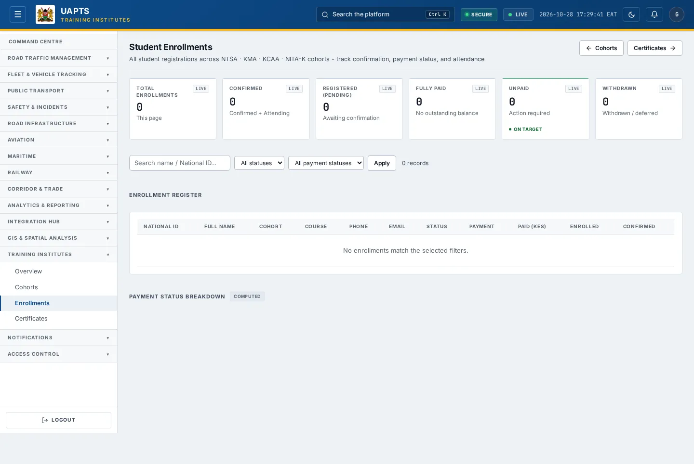
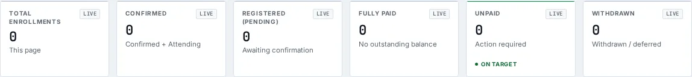

# Enrollments

_Training Institutes › Enrollments_ · Route `/training/enrollments`

**Student Enrollments** lets you see track confirmation, payment status, and attendance. Data on this page comes from All student registrations across NTSA, KMA, KCAA and NITA-K cohorts.

> 🎬 **Video tutorial:** _coming soon._  
> <!-- VIDEO-URL: training/enrollments | paste the link here, e.g. [Watch the walkthrough](https://…) -->

## Highlights

- **6 headline tiles** — Total Enrollments, Confirmed, Registered (Pending), Fully Paid, Unpaid, Withdrawn.
- **1 panels** — Enrollment Register.
- **Filters and search** to narrow tables to what you need.
- Every figure is traceable to the data feed or upload template that supplies it — see [Data sources and feeds](#data-sources-and-feeds).

## Enabling and access

1. Sign in to UAPTS (see [How to access](../getting-started/how-to-access.md)).
2. In the left sidebar expand **Training Institutes** and click **Enrollments**.
3. The page opens at `/training/enrollments`. You can also reach it with the global search (**Ctrl + K**).

This page belongs to module **M14 · Training Institutes**. The sidebar and the global search only list pages your agency and role can open, and a link to a page you cannot reach sends you back to the Command Centre. If a page you expect is missing, ask your agency administrator to check your agency's [Module Access](../access-control/module-access.md).

## Page tour

### Headline tiles

| Tile | What it shows | Data from | Table → ingested via |
|---|---|---|---|
| **Total Enrollments** | This page _(window: LIVE)_ | `/training/enrollments/` | _TrainingEnrollment_ → no template yet |
| **Confirmed** | Confirmed + Attending _(window: LIVE)_ | — | — |
| **Registered (Pending)** | Awaiting confirmation _(window: LIVE)_ | — | — |
| **Fully Paid** | No outstanding balance _(window: LIVE)_ | — | — |
| **Unpaid** | Action required _(window: LIVE)_ | — | — |
| **Withdrawn** | Withdrawn / deferred _(window: LIVE)_ | — | — |

### Enrollment Register

Contains a table with the columns **National ID**, **Full Name**, **Cohort**, **Course**, **Phone**, **Email**, **Status**, **Payment**, **Paid (KES)**, **Enrolled**, **Confirmed**.

**Data from:** `/training/enrollments/`  
**Table → ingested via:** _TrainingEnrollment_ → no template yet

## Working with this page

1. Open **Training Institutes → Enrollments** from the sidebar.
2. Type in the **“Search name / National ID…”** box to filter what is shown.
3. Use the **All statuses** drop-down to narrow the list. Choices include: Registered, Confirmed, Attending, Completed, Failed, Withdrawn.
4. Use the **All payment statuses** drop-down to narrow the list. Choices include: Unpaid, Partial, Paid, Waived, Refunded.
5. Click **Apply** to use this action.

## Status and value meanings

These are the values the platform stores for the fields shown on this page (`value` followed by the label you see).

| Field | Table | Values |
|---|---|---|
| status | TrainingEnrollment | `registered` · `confirmed` Confirmed / Paid · `attending` · `completed` · `failed` · `withdrawn` · `deferred` |
| payment status | TrainingEnrollment | `unpaid` · `partial` Partially Paid · `paid` Fully Paid · `waived` · `refunded` |

## Data sources and feeds

Every number and table on this page is read from the API endpoints below. The **Ingested via** column says how the underlying records get into UAPTS: a downloadable **upload template** (xlsx/CSV, loaded through the [Integration Hub](../integration-hub/upload-and-connect.md)), a **live feed** that pushes records to the ingest API, or — where neither exists yet — it is stated plainly.

| Endpoint | Records | Ingested via |
|---|---|---|
| `GET /training/enrollments/` | Training Enrollments | **No ingestion template yet** — populated by seed data or direct entry |

Full details of every template (columns, formats) are in the [Data sources catalogue](../reference/data-sources.md). Interactive API documentation is available at `/api/docs/`.

## Permissions

| Who | What they can do here |
|---|---|
| Public / read-only accounts | View the page where the module is enabled for their agency (read-only). |
| Operator | View the page. |
| Analyst | View and **export CSV**. |
| Agency admin | Everything an analyst can do, plus the administrative capabilities listed in [Roles & Permissions](../access-control/roles-and-permissions.md). |
| Super admin | Sees every agency's data. |

**Agencies with the Training Institutes module:** full — SDT, KRC.

_Access is evaluated by the server from the baseline policy plus any agency overrides, so a super admin or agency admin may have changed it from the defaults above._

## Related topics

- [Overview](training-overview.md)
- [Cohorts](cohorts.md)
- [Certificates](certificates.md)
- [Training Institutes overview](index.md)
- [Upload & Connect (Integration Hub)](../integration-hub/upload-and-connect.md)
- [Data sources catalogue](../reference/data-sources.md)

## On this page

- [Highlights](#highlights)
- [Enabling and access](#enabling-and-access)
- [Page tour](#page-tour)
- [Working with this page](#working-with-this-page)
- [Status and value meanings](#status-and-value-meanings)
- [Data sources and feeds](#data-sources-and-feeds)
- [Permissions](#permissions)
- [Related topics](#related-topics)

## Support

- **Your agency administrator** is the first contact for access, role and data-quality questions.
- **Data feeds, templates and API questions:** `api-support@uapts.go.ke` (include the `X-Request-ID` response header from a failing call).
- **Security concerns:** `security@uapts.go.ke`. Do not report suspected vulnerabilities publicly.
