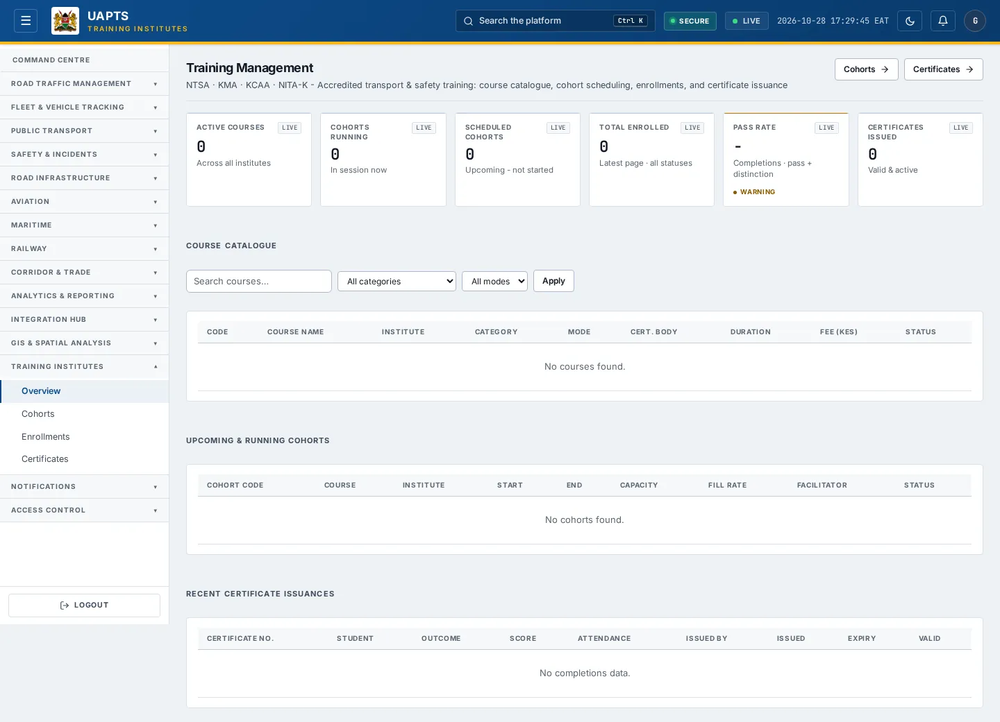
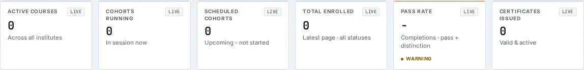

# Training Institutes — Overview

_Training Institutes › Overview_ · Route `/training`

**Training Management** lets you see accredited transport & safety training: course catalogue, cohort scheduling, enrollments, and certificate issuance. Data on this page comes from NTSA, KMA, KCAA and NITA-K.

> 🎬 **Video tutorial:** _coming soon._  
> <!-- VIDEO-URL: training/training-overview | paste the link here, e.g. [Watch the walkthrough](https://…) -->

## Highlights

- **6 headline tiles** — Active Courses, Cohorts Running, Scheduled Cohorts, Total Enrolled, Pass Rate, Certificates Issued.
- **3 panels** — Course Catalogue, Upcoming & Running Cohorts, Recent Certificate Issuances.
- **Filters and search** to narrow tables to what you need.
- Every figure is traceable to the data feed or upload template that supplies it — see [Data sources and feeds](#data-sources-and-feeds).

## Enabling and access

1. Sign in to UAPTS (see [How to access](../getting-started/how-to-access.md)).
2. In the left sidebar expand **Training Institutes** and click **Overview**.
3. The page opens at `/training`. You can also reach it with the global search (**Ctrl + K**).

This page belongs to module **M14 · Training Institutes**. The sidebar and the global search only list pages your agency and role can open, and a link to a page you cannot reach sends you back to the Command Centre. If a page you expect is missing, ask your agency administrator to check your agency's [Module Access](../access-control/module-access.md).

## Page tour

### Headline tiles

| Tile | What it shows | Data from | Table → ingested via |
|---|---|---|---|
| **Active Courses** | Across all institutes _(window: LIVE)_ | `/training/courses/` | _TrainingCourse_ → no template yet |
| **Cohorts Running** | In session now _(window: LIVE)_ | `/training/cohorts/` | _TrainingCohort_ → no template yet |
| **Scheduled Cohorts** | Upcoming - not started _(window: LIVE)_ | `/training/cohorts/` | _TrainingCohort_ → no template yet |
| **Total Enrolled** | Latest page · all statuses _(window: LIVE)_ | `/training/enrollments/` | _TrainingEnrollment_ → no template yet |
| **Pass Rate** | Completions · pass + distinction _(window: LIVE)_ | `/training/completions/` | _TrainingCompletion_ → no template yet |
| **Certificates Issued** | Valid & active _(window: LIVE)_ | `/training/completions/` | _TrainingCompletion_ → no template yet |

### Course Catalogue

Contains a table with the columns **Code**, **Course Name**, **Institute**, **Category**, **Mode**, **Cert. Body**, **Duration**, **Fee (KES)**, **Status**.

**Data from:** `/training/cohorts/`, `/training/courses/`  
**Table → ingested via:** _TrainingCohort, TrainingCourse_ → no template yet

### Upcoming & Running Cohorts

Contains a table with the columns **Cohort Code**, **Course**, **Institute**, **Start**, **End**, **Capacity**, **Fill Rate**, **Facilitator**, **Status**.

**Data from:** `/training/cohorts/`, `/training/completions/`  
**Table → ingested via:** _TrainingCohort, TrainingCompletion_ → no template yet

### Recent Certificate Issuances

Contains a table with the columns **Certificate No.**, **Student**, **Outcome**, **Score**, **Attendance**, **Issued By**, **Issued**, **Expiry**, **Valid**.

**Data from:** `/training/completions/`  
**Table → ingested via:** _TrainingCompletion_ → no template yet

## Working with this page

1. Open **Training Institutes → Overview** from the sidebar.
2. Type in the **“Search courses…”** box to filter what is shown.
3. Use the **All categories** drop-down to narrow the list. Choices include: Class B - Light Vehicle, Class C - Heavy Goods, Class D - PSV, Defensive Driving, First Aid, Maritime Basic.
4. Use the **All modes** drop-down to narrow the list. Choices include: In Person, Online, Blended.
5. Click **Apply** to use this action.

## Status and value meanings

These are the values the platform stores for the fields shown on this page (`value` followed by the label you see).

| Field | Table | Values |
|---|---|---|
| status | TrainingCohort | `scheduled` · `ongoing` · `completed` · `cancelled` |
| outcome | TrainingCompletion | `pass` · `fail` · `distinction` Pass with Distinction · `incomplete` · `deferred_resit` Deferred - Resit Required |
| course category | TrainingCourse | `class_a_motorcycle` Class A - Motorcycle · `class_b_light` Class B - Light Motor Vehicle · `class_c_heavy` Class C - Heavy Goods Vehicle · `class_d_psv` Class D - Public Service Vehicle · `class_e_special` Class E - Special Purpose Vehicle · `defensive_driving` · `first_aid` First Aid / Emergency Response · `maritime_basic` Maritime - Basic Safety Training (STCW) · `maritime_advanced` Maritime - Advanced Safety Training · `aviation_ground` Aviation - Ground Handling · `aviation_cabin_crew` Aviation - Cabin Crew · `other` |
| delivery mode | TrainingCourse | `in_person` · `online` · `blended` |
| status | TrainingEnrollment | `registered` · `confirmed` Confirmed / Paid · `attending` · `completed` · `failed` · `withdrawn` · `deferred` |

## Data sources and feeds

Every number and table on this page is read from the API endpoints below. The **Ingested via** column says how the underlying records get into UAPTS: a downloadable **upload template** (xlsx/CSV, loaded through the [Integration Hub](../integration-hub/upload-and-connect.md)), a **live feed** that pushes records to the ingest API, or — where neither exists yet — it is stated plainly.

| Endpoint | Records | Ingested via |
|---|---|---|
| `GET /training/cohorts/` | Training Cohorts | **No ingestion template yet** — populated by seed data or direct entry |
| `GET /training/completions/` | Training Completions | **No ingestion template yet** — populated by seed data or direct entry |
| `GET /training/courses/` | Training Courses | **No ingestion template yet** — populated by seed data or direct entry |
| `GET /training/enrollments/` | Training Enrollments | **No ingestion template yet** — populated by seed data or direct entry |

Full details of every template (columns, formats) are in the [Data sources catalogue](../reference/data-sources.md). Interactive API documentation is available at `/api/docs/`.

## Permissions

| Who | What they can do here |
|---|---|
| Public / read-only accounts | View the page where the module is enabled for their agency (read-only). |
| Operator | View the page. |
| Analyst | View and **export CSV**. |
| Agency admin | Everything an analyst can do, plus the administrative capabilities listed in [Roles & Permissions](../access-control/roles-and-permissions.md). |
| Super admin | Sees every agency's data. |

**Agencies with the Training Institutes module:** full — SDT, KRC.

_Access is evaluated by the server from the baseline policy plus any agency overrides, so a super admin or agency admin may have changed it from the defaults above._

## Related topics

- [Cohorts](cohorts.md)
- [Enrollments](enrollments.md)
- [Certificates](certificates.md)
- [Training Institutes overview](index.md)
- [Upload & Connect (Integration Hub)](../integration-hub/upload-and-connect.md)
- [Data sources catalogue](../reference/data-sources.md)

## On this page

- [Highlights](#highlights)
- [Enabling and access](#enabling-and-access)
- [Page tour](#page-tour)
- [Working with this page](#working-with-this-page)
- [Status and value meanings](#status-and-value-meanings)
- [Data sources and feeds](#data-sources-and-feeds)
- [Permissions](#permissions)
- [Related topics](#related-topics)

## Support

- **Your agency administrator** is the first contact for access, role and data-quality questions.
- **Data feeds, templates and API questions:** `api-support@uapts.go.ke` (include the `X-Request-ID` response header from a failing call).
- **Security concerns:** `security@uapts.go.ke`. Do not report suspected vulnerabilities publicly.
